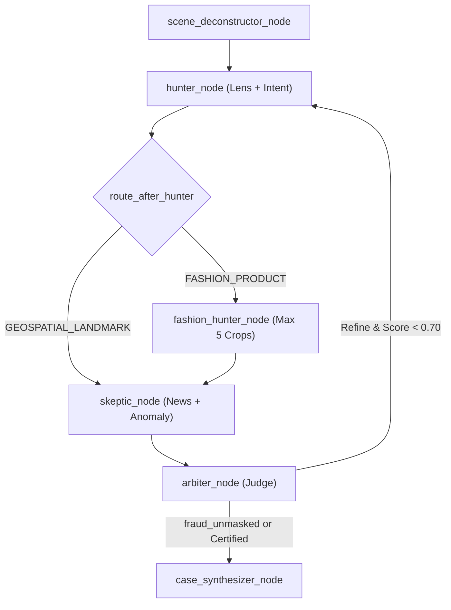

# C4 Code-Level Documentation: `backend/app/agent/nodes`

## 1. Overview
- **Name:** OSINT Swarm Investigative & Dialectical Nodes
- **Description:** Specialized investigative agents and state machine nodes implementing visual deconstruction, reverse-image search, geospatial triangulation, chronological auditing, ReAct reasoning, and Level 5 adversarial Hunter-Skeptic debate.
- **Location:** [`backend/app/agent/nodes`](file:///d:/SerpAPI_hackathon/backend/app/agent/nodes)
- **Language:** Python 3.11+
- **Purpose:** Core investigative logic within the LangGraph OSINT execution graph, processing raw input targets into structured multi-modal intelligence evidence.

---

## 2. Code Elements

### 2.1 `scene_deconstructor.py`
- **Function:** `scene_deconstructor_node(state: OsintGraphState) -> Dict[str, Any]`
  - **Location:** [`backend/app/agent/nodes/scene_deconstructor.py#L11-L58`](file:///d:/SerpAPI_hackathon/backend/app/agent/nodes/scene_deconstructor.py#L11-L58)
  - **Description:** Deconstructs suspect image into atomic forensic clues across architecture, signage scripts, flora/climate, and infrastructure bounding boxes.
  - **Dependencies:** `backend.app.agent.state.OsintGraphState`, `backend.app.services.vision_service.VisionService`.

### 2.2 `lens_hunter.py`
- **Function:** `lens_hunter_node(state: OsintGraphState) -> Dict[str, Any]`
  - **Location:** [`backend/app/agent/nodes/lens_hunter.py#L11-L80`](file:///d:/SerpAPI_hackathon/backend/app/agent/nodes/lens_hunter.py#L11-L80)
  - **Description:** Executes SerpApi Google Lens visual provenance search to retrieve exact visual twins, knowledge graph entities, and publication links.
  - **Dependencies:** `backend.app.services.serpapi_service.SerpApiService`, `backend.app.models.case.Citation`.

### 2.3 `geo_triangulator.py`
- **Function:** `geo_triangulator_node(state: OsintGraphState) -> Dict[str, Any]`
  - **Location:** [`backend/app/agent/nodes/geo_triangulator.py#L11-L134`](file:///d:/SerpAPI_hackathon/backend/app/agent/nodes/geo_triangulator.py#L11-L134)
  - **Description:** Triangulates physical coordinates, place IDs, and street addresses via SerpApi Google Maps based on hypotheses derived from Lens and scene clues.
  - **Dependencies:** `backend.app.services.serpapi_service.SerpApiService`, `backend.app.models.case.GeoCandidate`.

### 2.4 `chrono_auditor.py`
- **Function:** `chrono_auditor_node(state: OsintGraphState) -> Dict[str, Any]`
  - **Location:** [`backend/app/agent/nodes/chrono_auditor.py#L11-L114`](file:///d:/SerpAPI_hackathon/backend/app/agent/nodes/chrono_auditor.py#L11-L114)
  - **Description:** Queries SerpApi Google News to audit temporal publication milestones, earliest image appearances, and historical events.
  - **Dependencies:** `backend.app.services.serpapi_service.SerpApiService`, `backend.app.models.case.TimelineEvent`.

### 2.5 `case_synthesizer.py`
- **Function:** `case_synthesizer_node(state: OsintGraphState) -> Dict[str, Any]`
  - **Location:** [`backend/app/agent/nodes/case_synthesizer.py#L250-L327`](file:///d:/SerpAPI_hackathon/backend/app/agent/nodes/case_synthesizer.py#L250-L327)
  - **Description:** Compiles accumulated evidence, runs AnomalyService and DorkService, calculates overall confidence score, generates structured markdown summary (dynamically invoking `LLMDetectiveAgentService.synthesize_summary` when Gemini key is available), and synthesizes final `CaseFile`.
- **Helper Functions:**
  - `calculate_confidence_score(...) -> float`
  - `generate_case_summary_markdown(...) -> str`

### 2.6 `react_supervisor.py`
- **Function:** `create_agent_thought(...) -> AgentThought`
  - **Location:** [`backend/app/agent/nodes/react_supervisor.py#L9-L27`](file:///d:/SerpAPI_hackathon/backend/app/agent/nodes/react_supervisor.py#L9-L27)
  - **Description:** Generates validated Pydantic `AgentThought` instances with structured step types.
- **Function:** `generate_agent_thought(...) -> str`
  - **Description:** Returns formatted monospace terminal telemetry stream string.

### 2.7 `swarm_nodes.py` (Level 5 Dialectical Swarm & Dynamic LLM Engine)
- **Function:** `hunter_node(state: OsintGraphState) -> Dict[str, Any]`
  - **Location:** [`backend/app/agent/nodes/swarm_nodes.py#L28-L230`](file:///d:/SerpAPI_hackathon/backend/app/agent/nodes/swarm_nodes.py#L28-L230)
  - **Description:** Proposes optimistic hypotheses, dispatches `tool_lens_search`, runs dynamic intent classification & entity disambiguation (`LLMSemanticReasoningService`), segments multi-item collages via `ObjectSeparationService` with HITL directives, and bypasses Google Maps if `intent == FASHION_PRODUCT`.
- **Function:** `fashion_hunter_node(state: OsintGraphState) -> Dict[str, Any]`
  - **Location:** [`backend/app/agent/nodes/swarm_nodes.py#L232-L415`](file:///d:/SerpAPI_hackathon/backend/app/agent/nodes/swarm_nodes.py#L232-L415)
  - **Description:** Decomposes moodboards/collages into itemized garments and accessories. Enforces strict quota defense (hard cap of max 5 items), calls `tool_lens_search` with normalized `crop_bbox`, and populates `itemized_dossier` and citations.
- **Function:** `skeptic_node(state: OsintGraphState) -> Dict[str, Any]`
  - **Location:** [`backend/app/agent/nodes/swarm_nodes.py#L417-L566`](file:///d:/SerpAPI_hackathon/backend/app/agent/nodes/swarm_nodes.py#L417-L566)
  - **Description:** Adversarial red-team auditor. Implements two-tier dynamic fraud evaluation: Tier-1 dispatches semantic cross-examination via `LLMDetectiveAgentService.evaluate_skeptic` comparing user caption against SerpApi ground truth; Tier-2 engages deterministic `AnomalyService.detect_anomalies` fallback when offline.
- **Function:** `arbiter_node(state: OsintGraphState) -> Dict[str, Any]`
  - **Location:** [`backend/app/agent/nodes/swarm_nodes.py#L568-L666`](file:///d:/SerpAPI_hackathon/backend/app/agent/nodes/swarm_nodes.py#L568-L666)
  - **Description:** Dialectical judge weighing Hunter hypotheses vs Skeptic critiques. Tier-1 dynamically calls `LLMDetectiveAgentService.arbitrate_case` computing continuous `adversarial_audit_score` (0.0 to 1.0) and official verdict (`fraud_unmasked`, `debate_certified`, `refining_debate`); Tier-2 engages deterministic heuristic fallback.

---

## 3. Dependencies
- **Internal:**
  - `backend.app.agent.state.OsintGraphState`
  - `backend.app.agent.tools.*`
  - `backend.app.services.serpapi_service.SerpApiService`
  - `backend.app.services.vision_service.VisionService`
  - `backend.app.services.intent_service.IntentClassificationService`
  - `backend.app.services.llm_reasoning_service.LLMSemanticReasoningService`
  - `backend.app.services.llm_agent_service.LLMDetectiveAgentService`
  - `backend.app.services.object_separation_service.ObjectSeparationService`
  - `backend.app.services.anomaly_service.AnomalyService`
  - `backend.app.services.dork_service.DorkService`
  - `backend.app.models.case.*`
  - `backend.app.models.llm_agent.*`
  - `backend.app.models.react.*`
- **External:** `langgraph`, `pydantic`, `logging`, `uuid`, `httpx`

---

## 4. Relationships (Mermaid)

