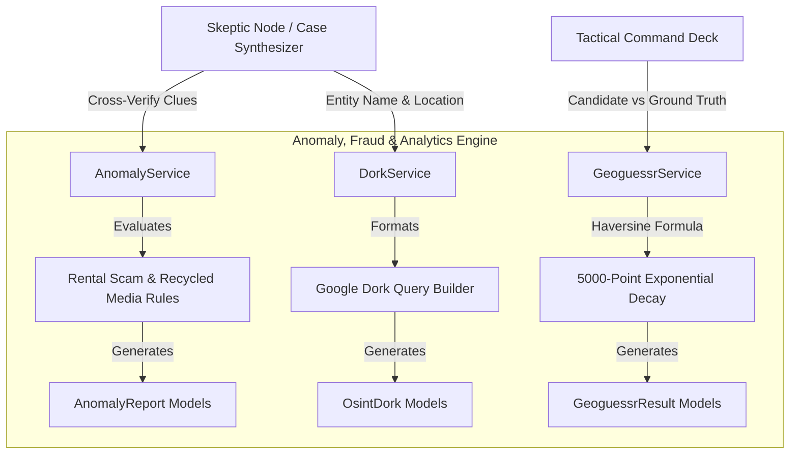

# C4 Component: Anomaly, Fraud & OSINT Dork Engine

## 1. Overview
- **Name:** Anomaly, Fraud & OSINT Dork Engine
- **Description:** Specialized forensic analysis engine that cross-references visual matches, spatial ground truths, and historical news archives to uncover rental listing fraud, recycled media disinformation, and automated Google dork pivots.
- **Type:** Domain Analytics & Heuristic Evaluation Engine
- **Technology:** Python 3.11, Pydantic V2, Haversine Trigonometry, Regex Pattern Matching

---

## 2. Purpose
Transforms raw search hits into actionable forensic intelligence. It addresses the challenge of adversarial deception in open-source intelligence—such as rental scammers using luxury overseas resort photos or social media users recirculating years-old footage as breaking news.

---

## 3. Software Features
- **Rental Scam & Real Estate Fraud Detection:** Cross-checks claimed residential listings against Google Lens commercial matches (e.g. unmasking a claimed Miami apartment as a boutique resort in Oia, Santorini).
- **Recirculated Media / Disinformation Analysis:** Flags temporal discrepancies between claimed current event dates and historical publication records.
- **Automated OSINT Dork Generation:** Formulates targeted Google Search dorks across municipal property records, investigative news archives, government registries, and exposed file directories.
- **Geoguessr Gamification & Radius Narrowing:** Calculates WGS84 geodesic error distance, competitive 5,000-point scores ($5000 \cdot e^{-d / 1492.7}$), and progressive 4-phase spatial radius narrowing.

---

## 4. Code Elements
Synthesizes and integrates the following code documentation files:
- [`c4-code-backend-app-services.md`](file:///d:/SerpAPI_hackathon/C4-Documentation/c4-code-backend-app-services.md): `anomaly_service.py`, `dork_service.py`, `geoguessr_service.py`.

---

## 5. Interfaces
- **Anomaly Detection:**
  - `AnomalyService.detect_anomalies(context_hint: Optional[str], image_path: Optional[str], resolved_location: Optional[GeoCandidate], lens_matches: Optional[List[Dict[str, Any]]], timeline_events: Optional[List[TimelineEvent]]) -> List[AnomalyReport]`
- **OSINT Dork Generation:**
  - `DorkService.generate_dorks(entity_name: str, location_address: str = "") -> List[OsintDork]`
- **Geoguessr Evaluation:**
  - `GeoguessrService.calculate_haversine_distance_km(lat1: float, lon1: float, lat2: float, lon2: float) -> float`
  - `GeoguessrService.calculate_geoguessr_score(distance_km: float) -> int`
  - `GeoguessrService.generate_tightening_stages(distance_km: float, location_name: str, candidate_name: str) -> List[TighteningStage]`

---

## 6. Dependencies
- **Components Used:**
  - **Evidence Data Models:** Emits `AnomalyReport`, `OsintDork`, and `GeoguessrResult`.
- **External Systems:**
  - Standard Python Math and URL libraries.

---

## 7. Component Diagram

