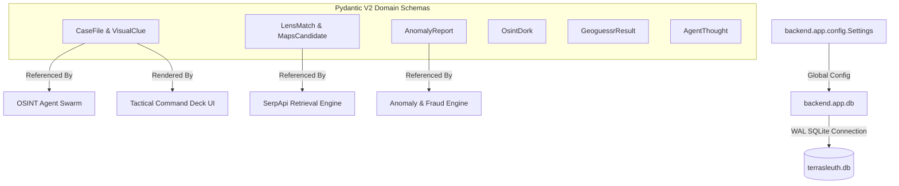

# C4 Component: Forensic Evidence & Schema Ledger

## 1. Overview
- **Name:** Forensic Evidence & Schema Ledger
- **Description:** Central typed domain model library and SQLite database persistence layer providing runtime schema validation, data serialization, and state persistence across all TerraSleuth subsystems.
- **Type:** Domain Model & Persistence Library
- **Technology:** Python 3.11, Pydantic V2, Pydantic Settings, SQLite3

---

## 2. Purpose
Provides a single source of truth for all domain entities, eliminating untyped dictionaries, preventing data structure drift between agent nodes, and guaranteeing that evidence claims are strictly validated with zero hallucinations.

---

## 3. Software Features
- **Pydantic V2 Data Contracts:** Enforces strict types, ranges ($0.0 \le \text{confidence} \le 1.0$), and normalized bounding boxes ($[ymin, xmin, ymax, xmax] \in [0.0, 1.0]$).
- **Domain Normalization:** Standardizes multi-engine SerpApi payloads into uniform `LensMatch`, `MapsCandidate`, `NewsItem`, and `OrganicResult` models.
- **Fraud & Anomaly Categorization:** Strongly typed `AnomalyReport` and `OsintDork` data structures.
- **SQLite Database Lifecycle:** Configures WAL-mode SQLite database connection with connection pooling and schema migrations.

---

## 4. Code Elements
Synthesizes and integrates the following code documentation files:
- [`c4-code-backend-app-models.md`](file:///d:/SerpAPI_hackathon/C4-Documentation/c4-code-backend-app-models.md): `case.py`, `serp.py`, `anomaly.py`, `dork.py`, `geoguessr.py`, `react.py`.
- [`c4-code-backend-app.md`](file:///d:/SerpAPI_hackathon/C4-Documentation/c4-code-backend-app.md): `config.py`, `db.py`.

---

## 5. Interfaces
- **Case File Schemas:**
  - `CaseFile`: Top-level case container.
  - `VisualClue`, `GeoCandidate`, `TimelineEvent`, `Citation`.
- **SerpApi Schemas:**
  - `LensVisualMatchesResult`, `MapsSearchResult`, `NewsSearchResult`, `GoogleSearchResult`.
- **Reasoning & Anomaly Schemas:**
  - `AgentThought`, `AnomalyReport`, `OsintDork`, `GeoguessrResult`.
- **Database Functions:**
  - `get_db_connection() -> sqlite3.Connection`
  - `init_db() -> None`
  - `get_golden_cases() -> list`

---

## 6. Dependencies
- **Components Used:**
  - Standard library and Pydantic runtime.
- **External Systems:**
  - SQLite database file (`terrasleuth.db`).

---

## 7. Component Diagram

