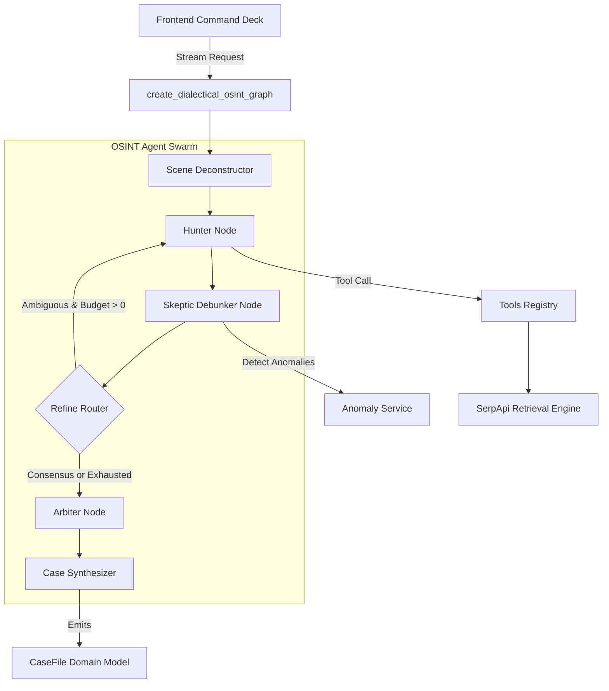

# C4 Component: OSINT Agent Swarm & ReAct Supervisor

## 1. Overview
- **Name:** OSINT Agent Swarm & ReAct Supervisor
- **Description:** Autonomous LangGraph state machine orchestrating Level 4 ReAct tool execution and Level 5 Dialectical Swarm (Hunter vs Skeptic vs Arbiter) hypothesis resolution.
- **Type:** Stateful Agent Orchestration Engine
- **Technology:** Python 3.11, LangGraph, LangChain Core Tools, Pydantic V2

---

## 2. Purpose
Solves the challenge of autonomous multi-modal geolocation and image provenance verification. Rather than relying on a static, rigid pipeline, this component:
1. Dynamically observes visual clues and dispatches targeted tool calls (Google Lens, Maps, News, Dorks).
2. Pitches an aggressive investigative hypothesis generator (**Hunter**) against a cynical, adversarial red-team debunker (**Skeptic**).
3. Emits live glass-box reasoning telemetry into a real-time monospace terminal.
4. Enforces strict circuit breakers and search budgets to prevent runaway execution loops.

---

## 3. Software Features
- **Level 4 ReAct Supervision:** Observe-Orient-Decide-Act (OODA) loops utilizing structured `AgentThought` streaming logs.
- **Level 5 Dialectical Tension:** Adversarial debate where the Skeptic tests climate, temporal recycling, and rental scam signals to invalidate Hunter claims.
- **Circuit Breaker Termination:** Strictly bounded refinement hops ($\le 2$) and search budgets preventing infinite recursion.
- **Synchronous SSE/Generator Streaming:** Yields incremental state snapshots to decouple graph compute from user interface updates.

---

## 4. Code Elements
Synthesizes and integrates the following code documentation files:
- [`c4-code-backend-app-agent-nodes.md`](file:///d:/SerpAPI_hackathon/C4-Documentation/c4-code-backend-app-agent-nodes.md): Investigation nodes (`scene_deconstructor`, `lens_hunter`, `geo_triangulator`, `chrono_auditor`, `case_synthesizer`, `hunter_node`, `skeptic_node`, `arbiter_node`, `react_supervisor`).
- [`c4-code-backend-app-agent.md`](file:///d:/SerpAPI_hackathon/C4-Documentation/c4-code-backend-app-agent.md): State schema (`state.py`), tool decorators (`tools.py`), and graph topologies (`graph.py`).

---

## 5. Interfaces
- **Graph Invocations:**
  - `create_osint_graph() -> StateGraph`: Compiles deterministic Level 3 pipeline.
  - `create_dialectical_osint_graph() -> StateGraph`: Compiles Level 5 Hunter/Skeptic/Arbiter state machine.
- **Streaming Entry Points:**
  - `stream_osint_investigation_sync(initial_state: Dict[str, Any]) -> Generator[Tuple[str, Dict[str, Any]], None, None]`
  - `stream_dialectical_investigation_sync(initial_state: Dict[str, Any]) -> Generator[Tuple[str, Dict[str, Any]], None, None]`
- **LangChain Tool Registry:**
  - `tool_lens_search(image_url: str, crop_bbox: Optional[List[float]])`
  - `tool_maps_triangulate(query: str, lat_hint: Optional[float], lon_hint: Optional[float])`
  - `tool_news_audit(query: str, date_filter: Optional[str])`
  - `tool_google_dork(dork_query: str)`
  - `tool_crop_region(image_path: str, bbox: List[float], label: str)`

---

## 6. Dependencies
- **Components Used:**
  - **SerpApi Multi-Modal Engine:** Queries Google Lens, Maps, and News through cached service proxies.
  - **Anomaly & Fraud Engine:** Skeptic node calls `AnomalyService` to uncover fraud flags.
  - **Evidence Schema Ledger:** Consumes and emits typed `OsintGraphState`, `GeoCandidate`, and `CaseFile` models.
- **External Systems:**
  - SerpApi Gateway (proxied through SQLite cache)
  - Vision LLMs (Google Gemini / OpenAI, with deterministic offline fallbacks)

---

## 7. Component Diagram

