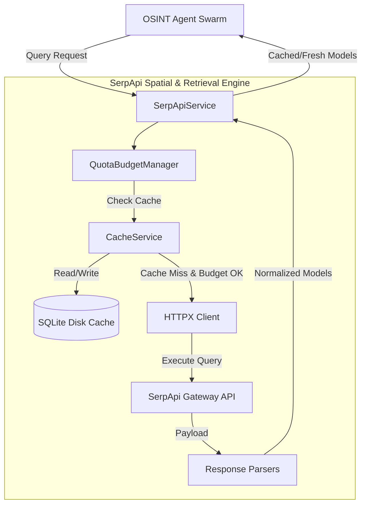

# C4 Component: SerpApi Multi-Modal & Spatial Retrieval Engine

## 1. Overview
- **Name:** SerpApi Multi-Modal & Spatial Retrieval Engine
- **Description:** Unified search abstraction layer combining Google Lens visual reverse-image search, Google Maps local place resolution, Google News chronological verification, and organic Google Search with SQLite quota defense.
- **Type:** Retrieval & Cache Infrastructure Service
- **Technology:** Python 3.11, HTTPX, SQLite3 (WAL Mode), Pillow, SHA-256 Hashing

---

## 2. Purpose
Provides reliable, high-speed, and secure external intelligence retrieval while protecting developer credits. Prevents runaway credit drain via an aggressive SQLite disk cache and session circuit breaker.

---

## 3. Software Features
- **Multi-Modal Visual Search:** Google Lens integration with high-resolution visual matches, exact matches, source domain attribution, and knowledge graph extraction.
- **Geospatial Triangulation:** Google Maps local places search resolving WGS84 latitude/longitude, place IDs, user ratings, and reviews.
- **Chronological Auditing:** Google News queries isolating earliest publication timestamps to identify original source media.
- **Quota Defense & SQLite Caching:** Deterministic SHA-256 key hashing excluding secrets and transient flags, guaranteeing that repeated queries and golden demo runs burn zero live API credits.
- **Client Session Budget Enforcement:** `QuotaBudgetManager` tracks and enforces query budgets, terminating runaway queries immediately.

---

## 4. Code Elements
Synthesizes and integrates the following code documentation files:
- [`c4-code-backend-app-services.md`](file:///d:/SerpAPI_hackathon/C4-Documentation/c4-code-backend-app-services.md): `serpapi_service.py`, `cache_service.py`, `quota_service.py`, `vision_service.py`.

---

## 5. Interfaces
- **SerpApiService Client Methods:**
  - `search_lens(image_url: str, hl: str = "en", force_refresh: bool = False) -> LensVisualMatchesResult`
  - `search_maps(query: str, ll: Optional[str] = None, hl: str = "en", force_refresh: bool = False) -> MapsSearchResult`
  - `search_news(query: str, time_range: Optional[str] = None, gl: str = "us", hl: str = "en", force_refresh: bool = False) -> NewsSearchResult`
  - `search_google(query: str, gl: str = "us", hl: str = "en", force_refresh: bool = False) -> GoogleSearchResult`
- **Cache Management:**
  - `get_cached_response(engine: str, params: Dict[str, Any]) -> Optional[Dict[str, Any]]`
  - `set_cached_response(engine: str, params: Dict[str, Any], response_data: Dict[str, Any], ttl_seconds: Optional[int]) -> bool`
  - `seed_golden_cases() -> int`
- **Image Processing:**
  - `crop_image_region(image_path: str, bbox: List[float], output_path: Optional[str]) -> str`

---

## 6. Dependencies
- **Components Used:**
  - **Evidence Data Models:** Serializes payloads into `LensMatch`, `MapsCandidate`, `NewsItem`, and `OrganicResult`.
- **External Systems:**
  - SerpApi Cloud Endpoints (`https://serpapi.com/search`)
  - SQLite Database (`terrasleuth.db`)

---

## 7. Component Diagram

