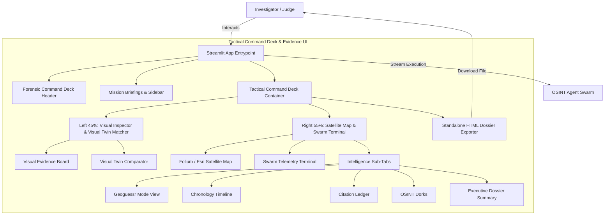

# C4 Component: Tactical Command Deck & Evidence UI

## 1. Overview
- **Name:** Tactical Command Deck & Evidence UI
- **Description:** Interactive Streamlit web interface presenting a 45/55 split-screen surveillance layout, high-contrast Folium/Esri satellite maps, side-by-side visual twin comparisons, real-time monospace agent telemetry, and standalone offline HTML dossier exporting.
- **Type:** Web Application UI Component
- **Technology:** Python 3.11, Streamlit, Folium / Leaflet, HTML5/CSS3, Pillow

---

## 2. Purpose
Delivers a pure, distraction-free product experience for investigators and hackathon evaluators. Replaces clunky tab navigation and raw JSON outputs with an immersive OSINT Forensic Command Deck interface that highlights multi-modal evidence with zero text truncation.

---

## 3. Software Features
- **Mission Briefings Deck:** High-tech HUD banner and 1-click briefing cards for instant benchmark selection.
- **45/55 Split-Screen Command Deck:**
  - Left: Visual Forensic Inspector with bounding box clue cards and side-by-side Google Lens visual twin matcher.
  - Right: Tactical Dark Matter / Esri Satellite map with glowing cyan pinpoint crosshair and consensus address banner.
- **Live Glass-Box Swarm Telemetry Terminal:** Monospace streaming terminal showing real-time timestamps, tool calls, and role tags (`[HUNTER]`, `[SKEPTIC]`, `[ARBITER]`).
- **Autonomous Geoguessr Mode:** Interactive 5,000-point accuracy scorecard with 4-phase spatial radius narrowing.
- **Standalone Offline HTML Dossier Exporter:** 1-Click generation of self-contained, zero-dependency HTML intelligence dossiers with embedded Base64 images and print styles.

---

## 4. Code Elements
Synthesizes and integrates the following code documentation files:
- [`c4-code-frontend.md`](file:///d:/SerpAPI_hackathon/C4-Documentation/c4-code-frontend.md): `app.py`.
- [`c4-code-frontend-components.md`](file:///d:/SerpAPI_hackathon/C4-Documentation/c4-code-frontend-components.md): `tactical_command_deck.py`, `war_room_hud.py`, `geo_map.py`, `visual_evidence_board.py`, `visual_twin_comparator.py`, `chronology_timeline.py`, `citation_ledger.py`, `geoguessr_view.py`, `swarm_telemetry_terminal.py`, `dossier_exporter.py`.

---

## 5. Interfaces
- **Master Render Functions:**
  - `render_tactical_command_deck(case_file: CaseFile, config: Dict[str, Any], ground_truth_lat: Optional[float], ground_truth_lon: Optional[float])`
  - `render_war_room_header()`
  - `render_mission_briefing()`
  - `generate_standalone_html_dossier(case_file: CaseFile, target_image: Optional[Image.Image]) -> str`
- **Map & Geospatial Visualizers:**
  - `create_folium_map(candidate: Optional[GeoCandidate], map_layer: str) -> folium.Map`
  - `render_geo_map(candidate: Optional[GeoCandidate], map_height: int)`
- **Telemetry Streamers:**
  - `render_swarm_telemetry_terminal(logs: List[Dict[str, str]], height: int)`

---

## 6. Dependencies
- **Components Used:**
  - **OSINT Agent Swarm:** Subscribes to synchronous generator streams (`stream_dialectical_investigation_sync`).
  - **Evidence Data Models:** Renders `CaseFile`, `VisualClue`, `GeoCandidate`, `TimelineEvent`, and `Citation`.
  - **Anomaly & Fraud Engine:** Displays anomaly alert banners and OSINT dork cards.
- **External Systems:**
  - Streamlit runtime
  - CartoDB & Esri Map Tile CDNs

---

## 7. Component Diagram

