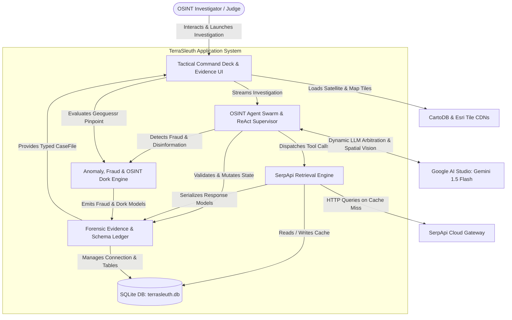

# C4 Component Architecture Index

## 1. System Components

The TerraSleuth system is organized into 5 logical, high-cohesion components:

| Component Name | Description | Documentation |
|---|---|---|
| **OSINT Agent Swarm & ReAct Supervisor** | Autonomous LangGraph state machine orchestrating Level 4 ReAct tool execution, Antigravity-Style Dynamic LLM Decision Engine (Google AI Studio Gemini 1.5 Flash), Dynamic Intent Routing & Entity Disambiguation, Multi-Modal Vision Decomposition, and Level 5 Dialectical Swarm (Hunter vs Skeptic vs Arbiter) hypothesis resolution with two-tier zero-credit fallback. | [`c4-component-osint-agent-swarm.md`](file:///d:/SerpAPI_hackathon/C4-Documentation/c4-component-osint-agent-swarm.md) |
| **SerpApi Multi-Modal & Spatial Retrieval Engine** | Unified search client combining SerpApi Image Upload API (`POST /image`), Google Lens reverse search & bounding-box crops, Google Maps, Google News, and Organic Search with SQLite quota defense and budget management. | [`c4-component-serpapi-spatial-engine.md`](file:///d:/SerpAPI_hackathon/C4-Documentation/c4-component-serpapi-spatial-engine.md) |
| **Anomaly, Fraud & OSINT Dork Engine** | Forensic cross-verification engine detecting rental scams, recycled media disinformation, Google dorks, and competitive Geoguessr scoring. | [`c4-component-anomaly-fraud-engine.md`](file:///d:/SerpAPI_hackathon/C4-Documentation/c4-component-anomaly-fraud-engine.md) |
| **Tactical Command Deck & Evidence UI** | Interactive Streamlit web interface delivering a 45/55 split-screen surveillance HUD, Folium/Esri satellite maps, Itemized Wardrobe & Product Forensic Ledger, visual twin comparator, and 1-click HTML dossier export. | [`c4-component-tactical-command-deck-ui.md`](file:///d:/SerpAPI_hackathon/C4-Documentation/c4-component-tactical-command-deck-ui.md) |
| **Forensic Evidence & Schema Ledger** | Central Pydantic V2 data model repository and WAL-mode SQLite database connection layer providing runtime type safety and persistence. | [`c4-component-evidence-data-models.md`](file:///d:/SerpAPI_hackathon/C4-Documentation/c4-component-evidence-data-models.md) |

---

## 2. Component Relationships Diagram

