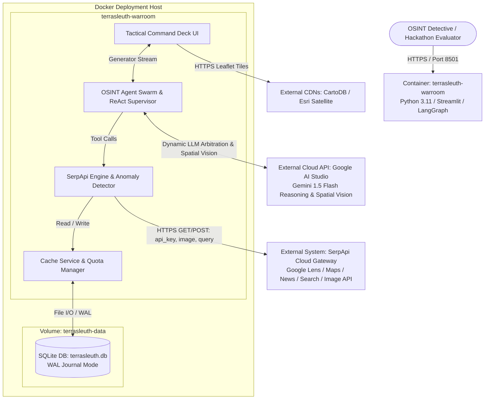

# C4 Container Architecture

## 1. Containers Overview

The TerraSleuth system is structured into containerized deployment units separating the interactive user interface, autonomous multi-agent graph computation, local SQLite persistence, and external cloud retrieval gateways.

| Container Name | Type | Technology | Deployment | Description |
|---|---|---|---|---|
| **TerraSleuth Application Container** (`terrasleuth-warroom`) | Web Application & Agent Runtime | Python 3.11, Streamlit, LangGraph, LangChain, Pillow, Folium | Docker Container (`python:3.11-slim`), Port 8501 | Runs the interactive Command Deck UI, hosts the LangGraph Dialectical Swarm, and coordinates domain services. |
| **Persistent SQLite Storage** (`terrasleuth-data`) | Relational Database & Volume | SQLite3 (WAL Mode), POSIX File System | Docker Named Volume mounted at `/app/data` & `/app/terrasleuth.db` | Persists pre-seeded golden benchmark cases, cached SerpApi query payloads, and cache statistics. |
| **SerpApi Cloud Gateway** (External) | Third-Party REST API | SerpApi JSON Endpoints | Multi-Region Cloud (`https://serpapi.com/search`) | Provides external search retrieval across Google Lens, Google Maps, Google News, and Google Search. |
| **Google AI Studio Cloud** (External) | Multi-Modal & LLM API | Google Gemini 1.5 Flash REST API (`x-goog-api-key`) | HTTPS REST Cloud | Powers the two-tier dynamic LLM decision engine (fraud debunker, continuous arbitration, executive synthesis) and 2D spatial vision decomposition (with zero-credit offline heuristic fallback). |

---

## 2. Purpose & Deployment Roles

### 2.1 `terrasleuth-warroom`
- **Role:** Main application workload container.
- **Deployment:** Packaged using [`Dockerfile`](file:///d:/SerpAPI_hackathon/Dockerfile) and [`docker-compose.yml`](file:///d:/SerpAPI_hackathon/docker-compose.yml).
- **Execution:** Boots Streamlit in headless server mode on port 8501 (`0.0.0.0`). Automatically runs startup database initialization and golden case seeding (`seed_golden_cases()`) on image build.

### 2.2 `terrasleuth-data`
- **Role:** Data durability and zero-quota demo replay.
- **Deployment:** Docker named volume mounted to preserve database state across container rebuilds.
- **Concurrency:** Operates under Write-Ahead Logging (`PRAGMA journal_mode=WAL;`), enabling simultaneous multi-threaded agent reads and writes without database lock contention.

---

## 3. Components Deployed in Each Container

### 3.1 `terrasleuth-warroom` Components
- [`c4-component-tactical-command-deck-ui.md`](file:///d:/SerpAPI_hackathon/C4-Documentation/c4-component-tactical-command-deck-ui.md): Tactical Command Deck & Evidence UI.
- [`c4-component-osint-agent-swarm.md`](file:///d:/SerpAPI_hackathon/C4-Documentation/c4-component-osint-agent-swarm.md): OSINT Agent Swarm & ReAct Supervisor.
- [`c4-component-serpapi-spatial-engine.md`](file:///d:/SerpAPI_hackathon/C4-Documentation/c4-component-serpapi-spatial-engine.md): SerpApi Multi-Modal & Spatial Retrieval Engine.
- [`c4-component-anomaly-fraud-engine.md`](file:///d:/SerpAPI_hackathon/C4-Documentation/c4-component-anomaly-fraud-engine.md): Anomaly, Fraud & OSINT Dork Engine.
- [`c4-component-evidence-data-models.md`](file:///d:/SerpAPI_hackathon/C4-Documentation/c4-component-evidence-data-models.md): Forensic Evidence & Schema Ledger.

### 3.2 `terrasleuth-data` Tables
- `serp_cache`: Keyed by SHA-256 deterministic hashes storing engine queries and JSON payloads.
- `golden_cases`: Stores benchmark target metadata, image paths, and ground truth coordinates.

---

## 4. Container Interfaces & API Specifications
- **Container HTTP Endpoints:**
  - `GET /_stcore/health`: Container health check used by Docker daemon (`HEALTHCHECK`).
  - `POST /api/investigate/stream`: Dialectical OSINT investigation event stream (SSE).
  - `GET /api/cases/golden`: List pre-seeded golden benchmark targets.
  - `GET /api/cache/stats`: Retrieve cache hit ratio and quota credit savings.
- **OpenAPI 3.1 Specification:**
  - Complete OpenAPI contract is published at: [`C4-Documentation/apis/terrasleuth-warroom-api.yaml`](file:///d:/SerpAPI_hackathon/C4-Documentation/apis/terrasleuth-warroom-api.yaml).

---

## 5. Dependencies & Protocols
- **Internal Communication:** In-process Python function calls and synchronous generator streaming between the UI layer and the LangGraph engine.
- **Storage Protocol:** SQLite file I/O via standard C-level sqlite3 bindings.
- **External Network Protocols:**
  - HTTPS / JSON to `https://serpapi.com/search` and `https://serpapi.com/image`.
  - HTTPS / REST with `x-goog-api-key` to Google AI Studio (`generativelanguage.googleapis.com`).
  - HTTPS CDN image requests to CartoDB and Esri tile endpoints.

---

## 6. Infrastructure & Resource Sizing
- **Base Image:** `python:3.11-slim` (Debian Linux base).
- **CPU / Memory Recommendation:** Minimum 1 vCPU, 1 GB RAM; Recommended 2 vCPU, 2 GB RAM.
- **Scaling Strategy:** Single-node stateful instance (or horizontally scalable behind a load balancer with external PostgreSQL/Redis if state is extracted).

---

## 7. Container Architecture Diagram

