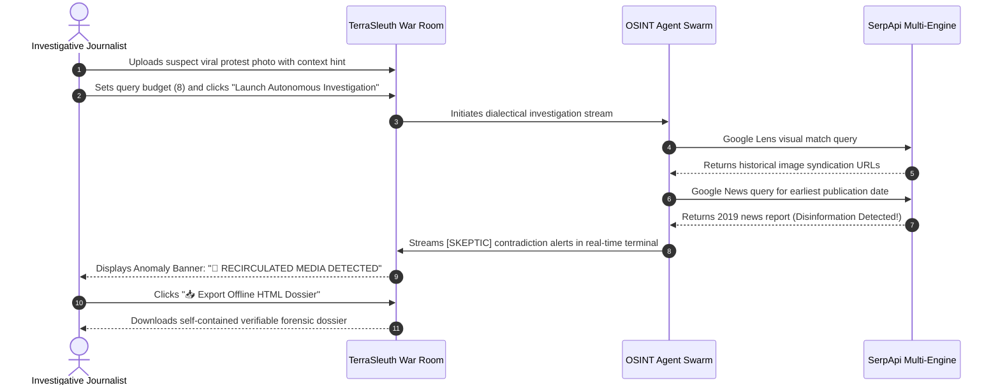
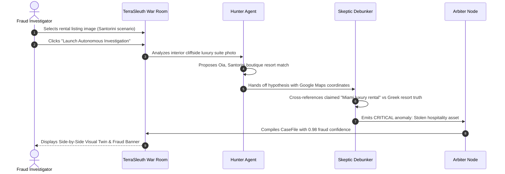

# C4 Context Architecture: TerraSleuth

## 1. System Overview

### 1.1 Short Description
**TerraSleuth** is an autonomous multi-modal visual and geospatial open-source intelligence (OSINT) detective that triangulates uncaptioned photographs to exact physical street coordinates, unmasks rental fraud, debunks viral media disinformation, and compiles court-admissible dossiers using SerpApi and a Level 5 dialectical multi-agent swarm.

### 1.2 Long Description
In high-stakes open-source intelligence workflows—such as verifying conflict zone imagery, evaluating human rights abuse claims, investigating online marketplace rental scams, or identifying disaster footage—human analysts spend hours manually cropping visual clues, cross-referencing reverse-image databases, querying satellite map layers, and searching archived news feeds.

TerraSleuth transforms this manual investigative process into an autonomous, glass-box multi-agent investigation. Combining SerpApi's multi-modal search engines (**Google Lens**, **Google Maps**, **Google News**, and **Google Search**) with a LangGraph multi-agent architecture featuring Level 4 ReAct tool execution and Level 5 Dialectical Swarm reasoning (**Hunter vs. Skeptic vs. Arbiter**), TerraSleuth:
- Deconstructs scenes into architectural, vegetation, signage, and landmark clues.
- Pitches an aggressive hypothesis generator (**Hunter**) against a cynical red-team auditor (**Skeptic**) to eliminate false positives and hallucinated landmarks.
- Cross-references visual matches against spatial consensus and historical publication timestamps to unmask stolen rental photos and recirculated viral media.
- Delivers an immersive War Room 2.0 tactical dashboard featuring a 45/55 split-screen command deck, Leaflet/Esri satellite recon pinpointing, interactive Geoguessr 5,000-point scoring, and 1-click exportable offline HTML intelligence dossiers.
- Defends developer quotas through an integrated SQLite disk cache, ensuring that golden benchmarks run 100% offline with zero live API credit consumption.

---

## 2. Personas & Stakeholders

### 2.1 Human Personas

#### Persona 1: Investigative Journalist & Conflict Verifier (e.g., Bellingcat / Fact-Checkers)
- **Role:** Independent journalist verifying breaking news photographs or viral social media footage.
- **Goals:** Prove where and when an uncaptioned photo was taken; expose recirculated archival media; establish verifiable provenance chains with tamper-evident citations.
- **Key Features Used:** Chronological Timeline Ledger, Citation Chain, Google News Historical Audit, Standalone HTML Dossier Export.

#### Persona 2: Real Estate & Marketplace Fraud Investigator
- **Role:** Cybercrime investigator or marketplace trust & safety officer identifying fraudulent vacation rentals.
- **Goals:** Determine if a luxury apartment photo listed for rent on Airbnb/Craigslist is a stolen marketing image from a commercial resort.
- **Key Features Used:** Anomaly & Fraud Detection Engine, Google Lens Commercial Attribution, Visual Twin Matcher.

#### Persona 3: Geoguessr Enthusiast & Competitive Geolocation Player
- **Role:** Competitive spatial analyst testing AI geolocation accuracy against ground truth.
- **Goals:** Pinpoint uncaptioned landscapes within a sub-50 meter walking radius; track progressive spatial radius narrowing from continental to street scale.
- **Key Features Used:** Autonomous Geoguessr Mode, 5,000-Point Exponential Decay Scorecard, 4-Phase Progressive Tightening Stages.

#### Persona 4: Hackathon Evaluator & Technical Judge
- **Role:** Evaluator assessing SerpApi utilization, multi-agent sophistication, product design, and architectural rigor.
- **Goals:** Verify live agent tool calls, inspect deterministic cache defense, review test suite health (108/108 passing), and audit C4 architecture.
- **Key Features Used:** Live Monospace Swarm Telemetry Terminal, Golden Mystery Targets, C4 Architecture Documentation, Offline Dossier Exporter.

### 2.2 Programmatic Personas

#### Persona 5: Automated E2E Regression & CI/CD Runner
- **Role:** Headless Playwright and Pytest automation suites running on continuous integration runners.
- **Goals:** Execute end-to-end regression suites, verify UI element reactivity, capture high-resolution visual evidence screenshots, and guarantee zero quota leaks.
- **Key Features Used:** SQLite WAL-mode cache layer, deterministic offline golden cases, Streamlit AppTest framework.

---

## 3. System Features & Capabilities

1. **Multi-Modal Visual Deconstruction:** Automatically extracts normalized bounding boxes for architectural arches, script typography, infrastructure poles, and flora.
2. **Autonomous ReAct Tool Dispatch (Level 4):** Agentic supervisor dynamically dispatches targeted SerpApi search tools (`tool_lens_search`, `tool_maps_triangulate`, `tool_news_audit`, `tool_google_dork`, `tool_crop_region`).
3. **Dialectical Swarm Tension (Level 5):** Hunter proposes location hypotheses; Skeptic actively attempts to falsify them by checking climate contradictions, architectural mismatches, and timestamp discrepancies; Arbiter certifies the consensus score.
4. **Forensic Fraud & Anomaly Detection:** Rules engine flags stolen hospitality photography, mismatched geographic coordinates, and temporal recirculations.
5. **Tactical Geospatial Reconnaissance:** High-contrast CartoDB Dark Matter and Esri World Imagery satellite map layers with pulsating consensus pins.
6. **Side-by-Side Visual Twin Matcher:** 50/50 comparison pane pitting the mystery target against top Google Lens matches with visual correspondence scores.
7. **Automated OSINT Dorks:** Formulates targeted Google Search queries for municipal property records, investigative archives, and open directories.
8. **1-Click Offline Dossier Exporter:** Exports zero-dependency HTML reports with embedded Base64 suspect photos, forensic telemetry, and print formatting.

---

## 4. User Journeys

### 4.1 Investigative Journalist / Conflict Verifier Journey


### 4.2 Real Estate Fraud Investigator Journey


---

## 5. External Systems & Dependencies

| External System | Type | Protocol | Role in TerraSleuth |
|---|---|---|---|
| **SerpApi Cloud Gateway** | External SaaS API | HTTPS / REST / JSON | Authoritative search proxy providing access to Google Lens, Google Maps, Google News, and Google Search. |
| **Vision LLM API (Gemini / OpenAI)** | External AI API | HTTPS / REST / JSON | Optional multi-modal vision models for dynamic image deconstruction when live keys are provided. |
| **Esri & CartoDB Tile CDNs** | Geospatial CDN | HTTPS / Tile Images | Delivers tactical Dark Matter and high-resolution Satellite Recon map tiles to the Leaflet UI. |
| **SQLite Persistent Database** | Local Database Storage | POSIX File I/O / WAL | Embedded relational storage managing the zero-quota query cache (`serp_cache`) and golden cases (`golden_cases`). |

---

## 6. System Context Diagram

```mermaid
graph TD
    Investigator([Investigative Journalist / Fact-Checker])
    FraudHunter([Rental Fraud / Trust & Safety Officer])
    Judge([Hackathon Evaluator / Technical Judge])
    AutoTest([Playwright & Pytest CI/CD Runner])

    subgraph TerraSleuth_Boundary [System Boundary: TerraSleuth]
        TerraSleuth[<b>TerraSleuth OSINT Platform</b><br>Autonomous Multi-Modal Visual & Geospatial Detective Engine<br><i>(Streamlit UI + LangGraph Swarm + SQLite Cache)</i>]
    end

    SerpApi[<b>SerpApi Cloud Gateway</b><br><i>Google Lens, Google Maps, Google News, Google Search</i>]
    VisionAPI[<b>Vision LLM Services</b><br><i>Google Gemini 1.5 / OpenAI GPT-4o</i>]
    MapTiles[<b>Geospatial Tile CDNs</b><br><i>Esri World Imagery / CartoDB Dark Matter</i>]
    LocalDisk[(<b>Local Host Storage</b><br><i>SQLite DB terrasleuth.db & Photographic Assets</i>)]

    Investigator -->|Uploads uncaptioned photo & reviews provenance timeline| TerraSleuth
    FraudHunter -->|Submits suspicious rental listing & downloads fraud dossier| TerraSleuth
    Judge -->|Launches golden demo & inspects monospace telemetry| TerraSleuth
    AutoTest -->|Executes automated regressions & headless E2E audits| TerraSleuth

    TerraSleuth -->|Dispatches reverse-image, spatial & news queries| SerpApi
    TerraSleuth -.->|Optional scene deconstruction prompts| VisionAPI
    TerraSleuth -->|Fetches satellite imagery & dark tiles| MapTiles
    TerraSleuth <-->|Reads & writes cached payloads under WAL mode| LocalDisk
```

---

## 7. Related Architecture Documentation
- Container Architecture & Deployment: [`c4-container.md`](file:///d:/SerpAPI_hackathon/C4-Documentation/c4-container.md)
- OpenAPI 3.1 Specification: [`apis/terrasleuth-warroom-api.yaml`](file:///d:/SerpAPI_hackathon/C4-Documentation/apis/terrasleuth-warroom-api.yaml)
- Master Component Index: [`c4-component.md`](file:///d:/SerpAPI_hackathon/C4-Documentation/c4-component.md)
- Subagent Roadmap & Sprints: [`docs/terrasleuth-roadmap.md`](file:///d:/SerpAPI_hackathon/docs/terrasleuth-roadmap.md)
- Regression Audit Scorecard: [`docs/terrasleuth-regression-audit.md`](file:///d:/SerpAPI_hackathon/docs/terrasleuth-regression-audit.md)
