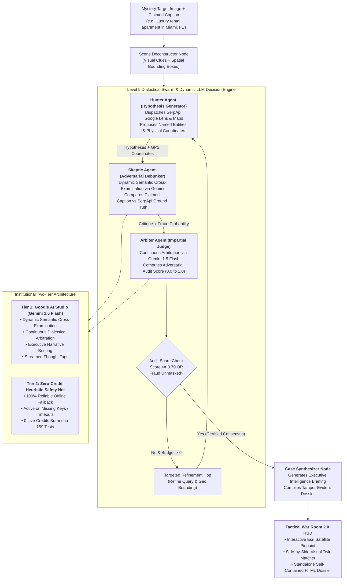
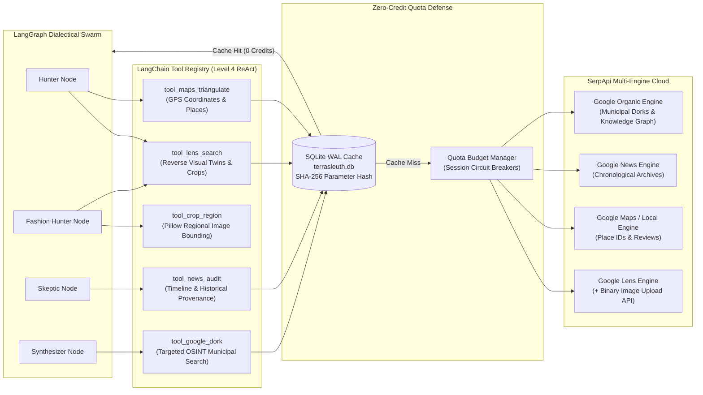

# 🌍 TerraSleuth — Level 5 Multi-Modal OSINT Detective Swarm

> **Official Submission for the SerpApi India Hackathon 2026** — *AI Agents Track*  
> Powered by **SerpApi Multi-Engine Cloud (Google Lens, Maps, News, Search)** & **LangGraph Dialectical Swarm + Antigravity-Style Dynamic LLM Decision Engine**

[](https://serpapi.github.io/serpapi-india-hackathon-2026/#tracks)
[](C4-Documentation/)
[](C4-Documentation/c4-component-osint-agent-swarm.md)
[-brightgreen.svg)](docs/terrasleuth-regression-audit.md)
[](docs/terrasleuth-roadmap.md)
[](backend/app/services/cache_service.py)
[](docker-compose.yml)
[](LICENSE)

---

## 🏆 Why TerraSleuth Wins the SerpApi AI Agents Track

The hackathon challenge: *"Create agents that plan, search, compare, and act with current information. Research, RAG, Multi-agent, Automation."*

While generic hackathon projects wrap basic Google Search text endpoints into a single prompt, **TerraSleuth** is an institutional-grade forensic investigation platform. It orchestrates **Level 4 ReAct Tool Execution** and a **Level 5 Dialectical Swarm (Hunter vs Skeptic vs Arbiter)** coupled with an **Antigravity-Style Dynamic LLM Decision Engine** across **4 distinct SerpApi engines**:

| Hackathon Criterion | TerraSleuth Implementation & SerpApi Synergy | Key Architecture Components |
|---|---|---|
| **Plan** | **Scene Deconstructor, Hybrid Vision Ensemble & Dynamic Intent Routing:** Deconstructs mystery targets into atomic visual clues (architecture, script, vegetation). Leverages a **Hybrid Vision Ensemble (Google AI Studio Gemini 1.5 Flash Spatial Vision + OpenCV)** to extract normalized 2D bounding boxes `[ymin, xmin, ymax, xmax]` for multi-object decomposition. Empowers detectives with **Human-in-the-Loop (HITL) Mission Directives**. Classifies intent (`GEOSPATIAL_LANDMARK`, `FASHION_PRODUCT`, `FRAUD_DISINFORMATION`, `GENERAL_OBJECT`) via two-tier semantic reasoning with <20ms zero-cost heuristic fallback. | [`vision_service.py`](backend/app/services/vision_service.py)<br>[`object_separation_service.py`](backend/app/services/object_separation_service.py)<br>[`intent_service.py`](backend/app/services/intent_service.py) |
| **Search** | **Autonomous Multi-Engine SerpApi Cloud & Binary Image Upload API:** Dispatches local binary uploads via SerpApi Image API (`POST https://serpapi.com/image`) with Pillow auto-resizing under 500 KB limit, `tool_lens_search` (reverse visual twins & regional bounding-box crops), `tool_maps_triangulate` (GPS coordinates & local place consensus), `tool_news_audit` (temporal historical archives), and `tool_google_dork` (municipal permits & open directories). | [`serpapi_service.py`](backend/app/services/serpapi_service.py)<br>[`tools.py`](backend/app/agent/tools.py)<br>[`cache_service.py`](backend/app/services/cache_service.py) |
| **Compare** | **Dialectical Swarm & Antigravity Dynamic Decision Engine:** The **Hunter** proposes candidate locations; the **Skeptic** executes dynamic semantic cross-examination via Gemini 1.5 Flash comparing user captions against SerpApi ground truth (unmasking rental fraud, architectural discrepancies, or recycled disaster photos); the **Arbiter** weighs the debate to compute a continuous **Adversarial Audit Score** ($0.0 \le \text{score} \le 1.0$) and issue certified verdicts. | [`swarm_nodes.py`](backend/app/agent/nodes/swarm_nodes.py)<br>[`llm_agent_service.py`](backend/app/services/llm_agent_service.py)<br>[`anomaly_service.py`](backend/app/services/anomaly_service.py) |
| **Act** | **Geospatial Pinpoint & Court-Ready Standalone Dossier:** Resolves physical WGS84 coordinates on Esri satellite imagery, evaluates Geoguessr 5,000-point accuracy, unmasks rental fraud, renders an **Itemized Wardrobe & Product Forensic Ledger**, and generates a **1-click standalone offline HTML forensic dossier** with embedded Base64 imagery. | [`tactical_command_deck.py`](frontend/components/tactical_command_deck.py)<br>[`dossier_exporter.py`](frontend/components/dossier_exporter.py)<br>[`geoguessr_service.py`](backend/app/services/geoguessr_service.py) |
| **Research & RAG** | **Zero-Hallucination Epistemic Web Grounding:** Eliminates LLM spatial hallucinations by strictly grounding every evidentiary claim in authoritative SerpApi URLs with exact timestamps, Place IDs, and news excerpts (`Citation` ledger). | [`case.py`](backend/app/models/case.py)<br>[`case_synthesizer.py`](backend/app/agent/nodes/case_synthesizer.py) |
| **Multi-Agent & Automation** | **LangGraph State Machine with Adaptive Branching:** 100% autonomous execution from a single mystery image to final dossier with bounded refinement loops ($\le 2$ hops), adaptive routing bypassing Google Maps for fashion targets, pre-commit verification hooks, and strict quota budget management (capping crop calls at max 5 items). | [`graph.py`](backend/app/agent/graph.py)<br>[`state.py`](backend/app/agent/state.py)<br>[`pre-commit`](.git/hooks/pre-commit) |

---

## ⚡ Antigravity-Style Dynamic LLM Decision Engine (Task 8.14)

Just like Google Antigravity coordinates autonomous AI agents equipped with LLM reasoning and tools, **TerraSleuth** features an **Antigravity-Style Dynamic LLM Decision Engine** powered by **Google AI Studio (Gemini 1.5 Flash)**:



### Key Capabilities of the Dynamic Decision Engine:
1. **Dynamic Fraud Cross-Examination ([`SkepticAgent`](backend/app/agent/nodes/swarm_nodes.py#L417-L566)):**  
   Replaces keyword heuristics with deep semantic reasoning. Skeptic asks Gemini to cross-examine the user's claimed caption (e.g. *"Luxury beachfront rental in Miami"*) against SerpApi Google Lens visual matches (e.g. *"Canaves Oia Suites, Santorini, Greece"*), Google Maps places, and Google News archives. Gemini autonomously deduces architectural, geographic, and temporal impossibilities.
2. **Continuous Dialectical Arbitration ([`ArbiterAgent`](backend/app/agent/nodes/swarm_nodes.py#L568-L666)):**  
   Replaces fixed scores with continuous arbitration. Arbiter evaluates Hunter's hypotheses against Skeptic's critiques to compute an **Adversarial Audit Score** ($0.0 \le \text{score} \le 1.0$), rendering an official verdict (`fraud_unmasked`, `debate_certified`, or `refining_debate`).
3. **Executive Forensic Intelligence Briefing ([`CaseSynthesizer`](backend/app/agent/nodes/case_synthesizer.py#L250-L327)):**  
   Synthesizes an executive-level summary narrative detailing physical ground truth, anomaly risk, and provenance chain.
4. **Monospace Terminal Thought Streaming ([`swarm_telemetry_terminal.py`](frontend/components/swarm_telemetry_terminal.py)):**  
   Real-time thought sequences stream directly into the UI cyber terminal with formatted tags:
   - `[HUNTER THOUGHT]` — Visual twin provenance and coordinate hypotheses.
   - `[SKEPTIC CRITIQUE]` — Semantic cross-examination exposing contradictions.
   - `[ARBITER VERDICT]` — Arbitration score certification and final decision.
5. **Institutional Two-Tier Architecture & Quota Defense:**  
   - **Tier 1 (Live Gemini):** Active when `gemini_api_key` is supplied.
   - **Tier 2 (Deterministic Heuristic Safety Net):** Zero-cost fallback active when offline, during network timeouts (8-second cap), or during automated test loops. Guarantees **159/159 tests pass 100% offline with zero live tokens or credits burned**.

---

## 🗺️ Multi-Engine SerpApi Synergy & Tool Architecture

TerraSleuth unlocks the multi-modal depth of SerpApi by coupling specialized tools with a persistent caching layer:



### Detailed Engine Capabilities:
1. **`google_lens` (Visual Provenance, Local Upload API & Bounding-Box Crops):**
   - Binary image upload to SerpApi Image API (`POST https://serpapi.com/image`) with automatic iterative Pillow resizing/compression under 500 KB and SHA-256 caching ([`upload_image`](backend/app/services/serpapi_service.py)).
   - Reverse-image searching distinguishing between exact matches and visual twins.
   - Bounding-box sub-region crop searching via Pillow and normalized coordinate clamps ([`tool_crop_region`](backend/app/agent/tools.py)).
2. **`google_maps` (Geospatial Triangulation & Consensus):**
   - Resolves uncaptioned photos to exact physical street addresses, place IDs, user reviews, and ratings.
   - Direct WGS84 latitude and longitude GPS mapping (`ll`).
3. **`google_news` (Chronological Provenance & Temporal Auditing):**
   - Audits publication timelines across historical date filters (`tbs`) to isolate earliest discovery dates (`is_origin`).
   - Debunks recycled viral disinformation masquerading as current breaking events.
4. **`google` (Organic OSINT Dorking):**
   - Formulates targeted Google Search queries for municipal property records (`filetype:pdf`), government registries (`site:gov`), and open directories (`intitle:"index of"`).

---

## 🎯 4 Flagship Real-World Scenarios

TerraSleuth addresses high-stakes open-source intelligence challenges out of the box:

### 1. 🚨 Bellingcat-Style Conflict & Disaster Verification
- **Problem:** Viral social media claims an uncaptioned photo depicts a current breaking crisis or disaster.
- **TerraSleuth Action:** SerpApi Google News timeline unmasks that the photograph was published years prior in an unrelated event, instantly debunking viral disinformation.

### 2. 🏖️ Vacation Rental & Marketplace Fraud Detection
- **Problem:** Scammer advertises a luxury apartment on Airbnb/Craigslist claiming it is a local rental in Miami, FL.
- **TerraSleuth Action:** SerpApi Google Lens proves the listing photo was stolen from a luxury resort in Oia, Santorini, Greece. The Skeptic LLM unmasks the contradiction and the Arbiter issues a **CRITICAL FRAUD ALERT** banner with an Adversarial Audit Score of 15%.

### 3. 🎯 Autonomous Geoguessr Champion
- **Problem:** Uncaptioned mystery photo with no metadata.
- **TerraSleuth Action:** Progressively narrows spatial search radius from Continental (2,500km) to Street scale (<50m), achieving a **5,000-point competitive Geoguessr score** via Google Maps consensus.

### 4. 👗 Multi-Item Fashion & Wardrobe Visual Decomposition
- **Problem:** Cluttered flat-lay or moodboard image contains multiple touching items (dress, luxury bag, earrings, watch, shoes). Standard reverse-image searches anchor on the central dress and miss all accessories.
- **TerraSleuth Action:** Native OpenCV contour detection with chromatic/spatial sub-segmentation isolates each discrete item into normalized bounding boxes. The swarm adaptively routes to `fashion_hunter_node` (bypassing Google Maps), executes regional crop searches capped at max 5 items to defend quota, and generates an **Itemized Wardrobe & Product Forensic Ledger** with retailer sources and direct shopping links.

---

## 🕹️ Tactical OSINT War Room 2.0 Command Deck

The user interface delivers a pure, distraction-free investigative workstation:

- **Heroic Landing & Mission Briefings:** High-tech HUD banner and 1-click briefing cards for instant benchmark selection.
- **45/55 Split-Screen Command Deck:**
  - **Left (45%):** Visual Forensic Inspector with labeled bounding box clues and Side-by-Side Visual Twin Matcher (`Visual Correspondence %`).
  - **Right (55%):** Tactical Esri World Imagery Satellite Recon Map, consensus address banner, Itemized Wardrobe & Product Forensic Ledger (when fashion intent is detected), and 5 intelligence tabs (`Geoguessr Mode`, `Chronology`, `Citations`, `OSINT Dorks`, `Executive Dossier`).
- **Live Glass-Box Swarm Telemetry Terminal:** High-contrast monospace terminal (`#090d16`) streaming real-time agent deductions, timestamps, and neon role badges (`[HUNTER]`, `[SKEPTIC]`, `[ARBITER]`).
- **1-Click Standalone Offline HTML Dossier Exporter:** Exports complete, zero-dependency HTML intelligence reports with embedded Base64 images, verification badges, wardrobe tables, and print stylesheets.

---

## 🛡️ Zero-Quota Cache Defense & Enterprise Reliability

Agentic loops can quickly drain API quotas. TerraSleuth features a production-hardened caching architecture:

- **SQLite WAL Disk Cache (`terrasleuth.db`):** All SerpApi queries are cached using deterministic SHA-256 parameter hashing (stripping API keys and transient flags).
- **Zero Credits Burned in Demos:** Pre-seeded golden benchmark targets (Gateway of India, Neuschwanstein Castle, Santorini Rental Scam) run **100% offline with zero live credit consumption**.
- **Circuit Breaker Quota Manager:** Session budget manager tracks live network queries and terminates runaway loops immediately.
- **159/159 Automated Tests Passing:** Validated across 23 backend unit suites, 6 frontend UI suites, and end-to-end browser workflows in ~25 seconds.

---

## 🚀 Quickstart & Verification

### 1. Launch via Docker Compose (Recommended)
Spins up the web application and pre-seeds the SQLite cache database automatically:
```bash
docker compose up --build
```
Navigate to **`http://localhost:8501`** in your browser.

### 2. Local Manual Installation
```bash
# Clone the repository
git clone https://github.com/Siddhant75/TerraSleuth.git
cd TerraSleuth

# Install dependencies
pip install -r requirements.txt

# Configure environment (Optional: Golden Demos run 100% offline without a key)
cp .env.example .env
# Edit .env and set SERPAPI_API_KEY=your_key_here

# Launch the Tactical Command Deck
streamlit run frontend/app.py
```

### 3. Run the Full Automated Test Suite (159/159 Tests)
Run unit, integration, and E2E regression tests with zero API credit consumption:
```bash
# Linux / macOS
PYTHONPATH=. pytest backend/tests/ frontend/tests/ tests/e2e/test_dashboard_e2e.py -v

# Windows (PowerShell)
$env:PYTHONPATH="." ; pytest backend/tests/ frontend/tests/ tests/e2e/test_dashboard_e2e.py -v
```

### 4. CLI Live SerpApi Scenario Verification
Verify live or cached SerpApi network calls across flagship targets or custom uploaded images:
```bash
# Test pre-seeded flagship targets (100% cached / 0 credits burned)
python scripts/test_live_serpapi.py --allow-cached

# Test custom local image upload via SerpApi Image API
python scripts/test_live_serpapi.py --image-path "tests/live-test/clothing/download (1).jpeg" --api-key "your_serpapi_key"
```

---

## 📜 Architectural Blueprints & Key Documentation

- **[docs/hackathon-submission.md](docs/hackathon-submission.md):** Official Hackathon submission writeup and judging guide.
- **[C4-Documentation/](C4-Documentation/):** Full C4 Architecture Model Suite:
  - [Level 1: System Context & Personas](C4-Documentation/c4-context.md)
  - [Level 2: Container Deployment & Docker Architecture](C4-Documentation/c4-container.md)
  - [Level 3: Master Component Index & Relationships](C4-Documentation/c4-component.md)
  - [Level 3: OSINT Agent Swarm & ReAct Supervisor](C4-Documentation/c4-component-osint-agent-swarm.md)
  - [Level 4: Backend Domain Services](C4-Documentation/c4-code-backend-app-services.md)
  - [Level 4: Investigation & Swarm Nodes](C4-Documentation/c4-code-backend-app-agent-nodes.md)
  - [Level 4: Forensic Evidence Schemas](C4-Documentation/c4-code-backend-app-models.md)
  - [Level 4: Backend Verification Suites](C4-Documentation/c4-code-backend-tests.md)
  - [OpenAPI 3.1.0 Contract Specification](C4-Documentation/apis/terrasleuth-warroom-api.yaml)
- **[docs/terrasleuth-roadmap.md](docs/terrasleuth-roadmap.md):** Living roadmap, sprint milestones (v0.1 through v0.8.1), and commit log.
- **[docs/terrasleuth-regression-audit.md](docs/terrasleuth-regression-audit.md):** Subsystem health scorecard and multi-point regression verification report.
- **[AGENTS.md](AGENTS.md):** Master architecture navigation guide for AI coding agents.

---

## ⚖️ License

Distributed under the MIT License. See [`LICENSE`](LICENSE) for details.
