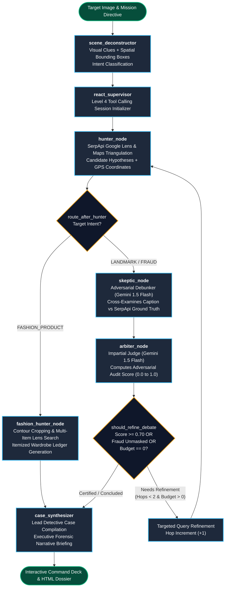
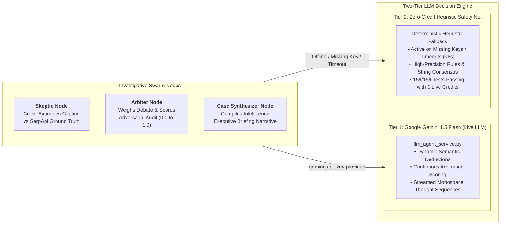
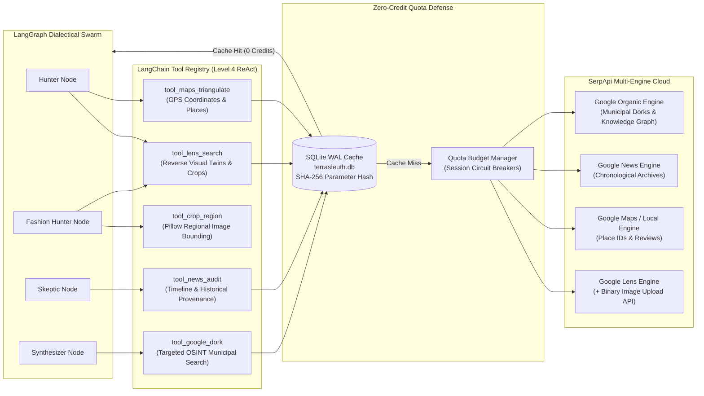

# 🌍 TerraSleuth — Autonomous Multi-Modal Visual & Geospatial OSINT Detective

> **Official Submission for the SerpApi India Hackathon 2026** — *AI Agents Track*  
> Powered by **SerpApi Multi-Engine Cloud (Google Lens, Maps, News, Search)**, **LangGraph State Machine**, **LangChain Tool Registry**, and **Google Gemini 1.5 Flash**.

[](https://serpapi.github.io/serpapi-india-hackathon-2026/#tracks)
[](backend/app/agent/graph.py)
[](backend/app/services/llm_agent_service.py)
[](C4-Documentation/)
[](C4-Documentation/c4-component-osint-agent-swarm.md)
[-brightgreen.svg)](docs/terrasleuth-regression-audit.md)
[](docs/terrasleuth-roadmap.md)
[](backend/app/services/cache_service.py)
[](docker-compose.yml)
[](LICENSE)

---

## 🏆 Why TerraSleuth Wins the SerpApi AI Agents Track

The hackathon challenge: *"Create agents that plan, search, compare, and act with current information. Research, RAG, Multi-agent, Automation."*

While conventional hackathon submissions wrap standard text search queries in a basic prompt, **TerraSleuth** is an institutional-grade open-source intelligence (OSINT) detective platform. It orchestrates a **LangGraph State Machine**, **LangChain Tool Primitives**, and a **Level 5 Dialectical Swarm (Hunter vs Skeptic vs Arbiter)** coupled with a **Two-Tier Dynamic LLM Decision Engine (Google Gemini 1.5 Flash + Deterministic Heuristic Fallback)** across **4 distinct SerpApi engines**:

| Hackathon Criterion | TerraSleuth Implementation & SerpApi Synergy | Key Architecture Components |
|---|---|---|
| **Plan** | **Scene Deconstructor, Hybrid Vision Ensemble & Dynamic Intent Routing:** Deconstructs mystery images into atomic visual clues (architecture, script, vegetation). Uses a **Hybrid Vision Ensemble (Google AI Studio Gemini 1.5 Flash Spatial Vision + OpenCV)** to extract normalized 2D bounding boxes `[ymin, xmin, ymax, xmax]` for multi-object decomposition. Empowers detectives with **Human-in-the-Loop (HITL) Mission Directives**. Classifies intent (`GEOSPATIAL_LANDMARK`, `FASHION_PRODUCT`, `FRAUD_DISINFORMATION`, `GENERAL_OBJECT`) via two-tier semantic reasoning with <20ms zero-cost heuristic fallback. | [`vision_service.py`](backend/app/services/vision_service.py)<br>[`object_separation_service.py`](backend/app/services/object_separation_service.py)<br>[`intent_service.py`](backend/app/services/intent_service.py) |
| **Search** | **Autonomous Multi-Engine SerpApi Cloud & Binary Image Upload API:** Dispatches local binary uploads via SerpApi Image API (`POST https://serpapi.com/image`) with Pillow auto-resizing under 500 KB limit, `tool_lens_search` (reverse visual twins & regional bounding-box crops), `tool_maps_triangulate` (GPS coordinates & local place consensus), `tool_news_audit` (temporal historical archives), and `tool_google_dork` (municipal permits & open directories). | [`serpapi_service.py`](backend/app/services/serpapi_service.py)<br>[`tools.py`](backend/app/agent/tools.py)<br>[`cache_service.py`](backend/app/services/cache_service.py) |
| **Compare** | **Dialectical Swarm & Dynamic LLM Decision Engine:** The **Hunter** proposes candidate locations; the **Skeptic** executes dynamic semantic cross-examination via Gemini 1.5 Flash comparing user captions against SerpApi ground truth (unmasking rental fraud, architectural discrepancies, or recycled disaster photos); the **Arbiter** weighs the debate to compute a continuous **Adversarial Audit Score** ($0.0 \le \text{score} \le 1.0$) and issue certified verdicts. | [`swarm_nodes.py`](backend/app/agent/nodes/swarm_nodes.py)<br>[`llm_agent_service.py`](backend/app/services/llm_agent_service.py)<br>[`anomaly_service.py`](backend/app/services/anomaly_service.py) |
| **Act** | **Geospatial Pinpoint & Court-Ready Standalone Dossier:** Resolves physical WGS84 coordinates on Esri satellite imagery, evaluates Geoguessr 5,000-point accuracy, unmasks rental fraud, renders an **Itemized Wardrobe & Product Forensic Ledger**, and generates a **1-click standalone offline HTML forensic dossier** with embedded Base64 imagery. | [`tactical_command_deck.py`](frontend/components/tactical_command_deck.py)<br>[`dossier_exporter.py`](frontend/components/dossier_exporter.py)<br>[`geoguessr_service.py`](backend/app/services/geoguessr_service.py) |
| **Research & RAG** | **Zero-Hallucination Epistemic Web Grounding:** Eliminates LLM spatial hallucinations by strictly grounding every evidentiary claim in authoritative SerpApi URLs with exact timestamps, Place IDs, and news excerpts (`Citation` ledger). | [`case.py`](backend/app/models/case.py)<br>[`case_synthesizer.py`](backend/app/agent/nodes/case_synthesizer.py) |
| **Multi-Agent & Automation** | **LangGraph State Machine with Adaptive Branching:** 100% autonomous execution from a single mystery image to final dossier with bounded refinement loops ($\le 2$ hops), adaptive routing bypassing Google Maps for fashion targets, pre-commit verification hooks, and strict quota budget management (capping crop calls at max 5 items). | [`graph.py`](backend/app/agent/graph.py)<br>[`state.py`](backend/app/agent/state.py)<br>[`pre-commit`](.git/hooks/pre-commit) |

---

## 🧠 LangChain & LangGraph Multi-Agent Architecture

TerraSleuth builds directly on **LangChain** and **LangGraph** to construct a deterministic, inspectable, and resilient OSINT workflow.



### 1. LangGraph State Machine (`StateGraph(OsintGraphState)`)
The core investigative engine in [`backend/app/agent/graph.py`](backend/app/agent/graph.py) is a compiled LangGraph state machine powered by a strongly-typed schema in [`backend/app/agent/state.py`](backend/app/agent/state.py):
- **Typed State Channels with Reducers:** Fields like `visual_clues`, `candidate_locations`, and `citations` use pure-functional `merge_lists` reducers:
  ```python
  class OsintGraphState(TypedDict):
      image_data: bytes
      claimed_context: Optional[str]
      visual_clues: Annotated[List[VisualClue], merge_lists]
      candidate_locations: Annotated[List[GeoCandidate], merge_lists]
      citations: Annotated[List[Citation], merge_lists]
      debate_history: Annotated[List[str], merge_lists]
      refinement_hops: int
      budget_remaining: int
  ```
- **Adaptive Conditional Routing (`route_after_hunter`):** Inspects detected intent and dynamically branches. For example, fashion targets are routed directly to `fashion_hunter_node` (bypassing Google Maps places to save credits), while geographic and fraud targets are routed to `skeptic_node` for dialectical cross-examination.
- **Cyclic Debate Loop with Circuit Breakers (`should_refine_debate`):** If the Arbiter determines ambiguity remains, the graph cycles back to `hunter_node` with refined search queries. Cycles are bounded by strict invariants: maximum 2 refinement hops (`refinement_hops <= 2`) and remaining API budget (`budget_remaining > 0`). Runaway loops are physically impossible.
- **Synchronous Real-Time Streaming (`stream_dialectical_investigation_sync`):** The graph streams intermediate state snapshots to the UI telemetry terminal at every node transition, giving users a real-time window into the agent's reasoning.

### 2. LangChain Tool Registry (`@tool` Primitives)
In [`backend/app/agent/tools.py`](backend/app/agent/tools.py), discrete investigative capabilities are exposed as LangChain `@tool` primitives with Pydantic parameter schemas:

| Tool | Engine Wrapped | Description & Parameters |
|---|---|---|
| `tool_lens_search` | SerpApi `google_lens` | Reverse image visual twin matching and bounding box crop searches (`image_data`, `crop_box`). |
| `tool_maps_triangulate` | SerpApi `google_maps` | High-precision geospatial coordinate resolution, Place IDs, and user reviews (`query`). |
| `tool_news_audit` | SerpApi `google_news` | Chronological publication archive auditing and first-seen date verification (`query`, `time_filter`). |
| `tool_google_dork` | SerpApi `google` | Municipal property records, government registries, and open directory discovery (`query`). |
| `tool_crop_region` | Pillow (Local Vision) | Sub-region image extraction using normalized coordinate clamping (`image_data`, `ymin`, `xmin`, `ymax`, `xmax`). |

Each tool integrates with the **SQLite WAL Disk Cache** (`cache_service.py`), ensuring that identical queries are retrieved in <2ms with zero credit consumption.

---

## ⚡ Dynamic Multi-Modal Reasoning & Two-Tier Architecture

TerraSleuth features a **Two-Tier Dynamic Multi-Agent Decision Engine** powered by **Google AI Studio (Gemini 1.5 Flash)** with a 100% reliable deterministic fallback:



### Key Capabilities of the Dynamic Decision Engine:
1. **Dynamic Fraud Cross-Examination ([`SkepticAgent`](backend/app/agent/nodes/swarm_nodes.py#L417-L566)):**  
   Replaces rigid keyword heuristics with deep semantic reasoning. Skeptic prompts Gemini to cross-examine claimed captions (e.g., *"Luxury beachfront rental in Miami"*) against SerpApi Google Lens visual matches (e.g., *"Canaves Oia Suites, Santorini, Greece"*), Google Maps places, and Google News archives. Gemini autonomously deduces architectural, geographic, and temporal impossibilities.
2. **Continuous Dialectical Arbitration ([`ArbiterAgent`](backend/app/agent/nodes/swarm_nodes.py#L568-L666)):**  
   Replaces fixed scores with continuous arbitration. Arbiter evaluates Hunter's hypotheses against Skeptic's critiques to compute an **Adversarial Audit Score** ($0.0 \le \text{score} \le 1.0$), rendering an official verdict (`fraud_unmasked`, `debate_certified`, or `refining_debate`).
3. **Executive Forensic Intelligence Briefing ([`CaseSynthesizer`](backend/app/agent/nodes/case_synthesizer.py#L250-L327)):**  
   Synthesizes an executive-level summary narrative detailing physical ground truth, anomaly risk, and provenance chain.
4. **Monospace Terminal Thought Streaming ([`swarm_telemetry_terminal.py`](frontend/components/swarm_telemetry_terminal.py)):**  
   Real-time thought sequences stream directly into the UI cyber terminal with formatted tags:
   - `[HUNTER THOUGHT]` — Visual twin provenance and coordinate hypotheses.
   - `[SKEPTIC CRITIQUE]` — Semantic cross-examination exposing contradictions.
   - `[ARBITER VERDICT]` — Arbitration score certification and final decision.
5. **Two-Tier Architecture & Quota Defense Invariant:**  
   - **Tier 1 (Live Gemini):** Active when `gemini_api_key` is supplied.
   - **Tier 2 (Deterministic Heuristic Safety Net):** Zero-cost fallback active when offline, during network timeouts (8-second cap), or during automated test loops. Guarantees **159/159 tests pass 100% offline with zero live tokens or credits burned**.

---

## 🗺️ Multi-Engine SerpApi Synergy & Tool Architecture

TerraSleuth unlocks the multi-modal depth of SerpApi by coupling specialized tools with a persistent caching layer:



### Detailed Engine Capabilities:
1. **`google_lens` (Visual Provenance, Local Upload API & Bounding-Box Crops):**
   - Binary image upload to SerpApi Image API (`POST https://serpapi.com/image`) with automatic iterative Pillow resizing/compression under 500 KB and SHA-256 caching ([`upload_image`](backend/app/services/serpapi_service.py)).
   - Reverse-image searching distinguishing between exact matches and visual twins.
   - Bounding-box sub-region crop searching via Pillow and normalized coordinate clamps ([`tool_crop_region`](backend/app/agent/tools.py)).
2. **`google_maps` (Geospatial Triangulation & Consensus):**
   - Resolves uncaptioned photos to exact physical street addresses, place IDs, user reviews, and ratings.
   - Direct WGS84 latitude and longitude GPS mapping (`ll`).
3. **`google_news` (Chronological Provenance & Temporal Auditing):**
   - Audits publication timelines across historical date filters (`tbs`) to isolate earliest discovery dates (`is_origin`).
   - Debunks recycled viral disinformation masquerading as current breaking events.
4. **`google` (Organic OSINT Dorking):**
   - Formulates targeted Google Search queries for municipal property records (`filetype:pdf`), government registries (`site:gov`), and open directories (`intitle:"index of"`).

---

## 🎯 4 Flagship Real-World Scenarios

TerraSleuth addresses high-stakes open-source intelligence challenges out of the box:

### 1. 🚨 Bellingcat-Style Conflict & Disaster Verification
- **Problem:** Viral social media claims an uncaptioned photo depicts a current breaking crisis or disaster.
- **TerraSleuth Action:** SerpApi Google News timeline unmasks that the photograph was published years prior in an unrelated event, instantly debunking viral disinformation.

### 2. 🏖️ Vacation Rental & Marketplace Fraud Detection
- **Problem:** Scammer advertises a luxury apartment on Airbnb/Craigslist claiming it is a local rental in Miami, FL.
- **TerraSleuth Action:** SerpApi Google Lens proves the listing photo was stolen from a luxury resort in Oia, Santorini, Greece. The Skeptic LLM unmasks the contradiction and the Arbiter issues a **CRITICAL FRAUD ALERT** banner with an Adversarial Audit Score of 15%.

### 3. 🎯 Autonomous Geoguessr Champion
- **Problem:** Uncaptioned mystery photo with no metadata.
- **TerraSleuth Action:** Progressively narrows spatial search radius from Continental (2,500km) to Street scale (<50m), achieving a **5,000-point competitive Geoguessr score** via Google Maps consensus.

### 4. 👗 Multi-Item Fashion & Wardrobe Visual Decomposition
- **Problem:** Cluttered flat-lay or moodboard image contains multiple touching items (dress, luxury bag, earrings, watch, shoes). Standard reverse-image searches anchor on the central dress and miss all accessories.
- **TerraSleuth Action:** Native OpenCV contour detection with chromatic/spatial sub-segmentation isolates each discrete item into normalized bounding boxes. The swarm adaptively routes to `fashion_hunter_node` (bypassing Google Maps), executes regional crop searches capped at max 5 items to defend quota, and generates an **Itemized Wardrobe & Product Forensic Ledger** with retailer sources and direct shopping links.

---

## 🖥️ Interactive OSINT Forensic Dashboard

The user interface delivers a pure, distraction-free investigative workstation:

- **Mission Briefings Deck:** 1-click scenario briefing cards for instant benchmark selection.
- **45/55 Split-Screen Command Deck:**
  - **Left (45%):** Visual Forensic Evidence Board with labeled bounding box clues and Side-by-Side Visual Twin Matcher (`Visual Correspondence %`).
  - **Right (55%):** Tactical Esri World Imagery Satellite Recon Map, consensus address banner, Itemized Wardrobe & Product Forensic Ledger (when fashion intent is detected), and 5 intelligence tabs (`Geoguessr Mode`, `Chronology`, `Citations`, `OSINT Dorks`, `Executive Dossier`).
- **Real-Time Multi-Agent Execution Telemetry Terminal:** High-contrast monospace terminal (`#090d16`) streaming real-time agent deductions, timestamps, and neon role badges (`[HUNTER]`, `[SKEPTIC]`, `[ARBITER]`).
- **1-Click Standalone Offline HTML Dossier Exporter:** Exports complete, zero-dependency HTML intelligence reports with embedded Base64 images, verification badges, wardrobe tables, and print stylesheets.

---

## 🗺️ Where to Look for What (Codebase Navigation Guide)

To help hackathon judges and open-source contributors navigate the repository quickly, here is the complete subsystem directory map:

| Subsystem | Primary Files | Architectural Concern |
|---|---|---|
| **LangGraph Agent Engine** | [`backend/app/agent/graph.py`](backend/app/agent/graph.py)<br>[`backend/app/agent/state.py`](backend/app/agent/state.py) | Compiled `StateGraph`, `OsintGraphState` TypedDict, pure reducers, conditional edges (`route_after_hunter`, `should_refine_debate`), and circuit breakers. |
| **Swarm Agent Nodes** | [`backend/app/agent/nodes/swarm_nodes.py`](backend/app/agent/nodes/swarm_nodes.py)<br>[`backend/app/agent/nodes/react_supervisor.py`](backend/app/agent/nodes/react_supervisor.py)<br>[`backend/app/agent/nodes/case_synthesizer.py`](backend/app/agent/nodes/case_synthesizer.py) | Hunter hypothesis generator, Skeptic adversarial debunker, Arbiter continuous judge, fashion itemization node, and lead detective synthesizer. |
| **LangChain Tools** | [`backend/app/agent/tools.py`](backend/app/agent/tools.py) | 5 discrete LangChain `@tool` primitives (`tool_lens_search`, `tool_maps_triangulate`, `tool_news_audit`, `tool_google_dork`, `tool_crop_region`). |
| **SerpApi Cloud & Cache** | [`backend/app/services/serpapi_service.py`](backend/app/services/serpapi_service.py)<br>[`backend/app/services/cache_service.py`](backend/app/services/cache_service.py) | SerpApi Google Lens, Maps, News, Search client, binary image upload API, and SQLite WAL disk cache (`terrasleuth.db`). |
| **Dynamic LLM Engine** | [`backend/app/services/llm_agent_service.py`](backend/app/services/llm_agent_service.py)<br>[`backend/app/services/llm_reasoning_service.py`](backend/app/services/llm_reasoning_service.py) | Google Gemini 1.5 Flash client, prompt engineering, structured JSON extraction, and two-tier heuristic fallback. |
| **Vision & Object Extraction** | [`backend/app/services/vision_service.py`](backend/app/services/vision_service.py)<br>[`backend/app/services/object_separation_service.py`](backend/app/services/object_separation_service.py) | Hybrid vision ensemble (Gemini Spatial Vision + OpenCV contour detection) for multi-object bounding box extraction. |
| **Intent & Anomaly Services** | [`backend/app/services/intent_service.py`](backend/app/services/intent_service.py)<br>[`backend/app/services/anomaly_service.py`](backend/app/services/anomaly_service.py)<br>[`backend/app/services/geoguessr_service.py`](backend/app/services/geoguessr_service.py) | Zero-cost intent routing, fraud anomaly analysis, and 5,000-point Geoguessr distance scoring. |
| **Data Models & Schemas** | [`backend/app/models/case.py`](backend/app/models/case.py)<br>[`backend/app/models/visual.py`](backend/app/models/visual.py)<br>[`backend/app/models/geo.py`](backend/app/models/geo.py)<br>[`backend/app/models/llm_agent.py`](backend/app/models/llm_agent.py)<br>[`backend/app/models/react.py`](backend/app/models/react.py) | Strongly-typed Pydantic schemas for forensic case dossiers, visual clues, candidates, citations, and ReAct steps. |
| **Interactive Dashboard (UI)** | [`frontend/app.py`](frontend/app.py)<br>[`frontend/components/tactical_command_deck.py`](frontend/components/tactical_command_deck.py)<br>[`frontend/components/visual_evidence_board.py`](frontend/components/visual_evidence_board.py)<br>[`frontend/components/swarm_telemetry_terminal.py`](frontend/components/swarm_telemetry_terminal.py)<br>[`frontend/components/dossier_exporter.py`](frontend/components/dossier_exporter.py) | Streamlit OSINT command deck, 45/55 split-screen layout, Leaflet/Folium satellite maps, visual twin matcher, monospace cyber terminal, and HTML dossier generator. |
| **Test Suites (159 Tests)** | [`backend/tests/`](backend/tests/)<br>[`frontend/tests/`](frontend/tests/)<br>[`tests/e2e/test_dashboard_e2e.py`](tests/e2e/test_dashboard_e2e.py) | 23 backend unit suites, 6 frontend UI suites, and Playwright end-to-end browser walkthroughs. |
| **Architecture Blueprints** | [`C4-Documentation/`](C4-Documentation/)<br>[`docs/hackathon-submission.md`](docs/hackathon-submission.md)<br>[`AGENTS.md`](AGENTS.md) | Comprehensive 4-tier C4 Architecture Model, official hackathon submission writeup, and AI agent navigation rules. |

---

## 🚀 App User Guide & 60-Second Judge Fast-Track Walkthrough

### 📦 Quickstart Setup

#### Option 1: Launch via Docker Compose (Recommended for Judges)
Spins up the web application and pre-seeds the SQLite cache database automatically:
```bash
docker compose up --build
```
Navigate to **`http://localhost:8501`** in your browser.

#### Option 2: Local Python Virtual Environment
```bash
# 1. Clone the repository
git clone https://github.com/Siddhant75/TerraSleuth.git
cd TerraSleuth

# 2. Create and activate virtual environment
python -m venv venv
# Windows (PowerShell):
.\venv\Scripts\Activate.ps1
# Linux / macOS:
source venv/bin/activate

# 3. Install dependencies
pip install -r requirements.txt

# 4. (Optional) Provide API keys in .env
# Note: Pre-seeded Golden Targets work 100% offline without any keys!
cp .env.example .env

# 5. Launch the Forensic Dashboard
streamlit run frontend/app.py
```

---

### ⏱️ 60-Second Judge Fast-Track Walkthrough

Follow these steps to evaluate TerraSleuth with **zero configuration and zero API credit burn**:

1. **Open the Dashboard:** Navigate to `http://localhost:8501`.
2. **Select a Golden Mystery Target:** In the left sidebar, click on any of the pre-seeded benchmark targets under **"Golden Mystery Targets"**:
   - 🏰 **The Waterfront Monument & Heritage Hotel** — Landmark pinpointing and high-confidence triangulation.
   - 🏖️ **Vacation Rental Listing Fraud** — Stolen resort photography unmasking with fraud alerts.
   - 👗 **Autumn Fashion Flat-Lay Decomposition** — Multi-item wardrobe bounding and catalog matching.
   - 🏰 **Bavarian Alpine Castle & Forest** — Continental-to-street Geoguessr triangulation.
3. **Launch the Swarm:** Click the blue **"🚀 Launch Autonomous Investigation"** button.
4. **Observe Real-Time Telemetry:** Watch the LangGraph state machine execute in the high-contrast monospace terminal:
   - Visual clues extracted with normalized 2D bounding boxes.
   - Hunter proposing candidate locations via SerpApi Google Lens and Maps.
   - Skeptic cross-examining captions and Arbiter certifying consensus scores.
5. **Inspect the 45/55 Split-Screen Command Deck:**
   - **Left:** View labeled bounding boxes on the target image, or click **"Side-by-Side Visual Twin Matcher"** to see side-by-side alignment against verified Wikipedia photography.
   - **Right:** Inspect the high-resolution Esri Satellite Map pinpointing exact coordinates, or view the 5,000-point Geoguessr scorecard.
6. **Export the Standalone HTML Dossier:** Scroll to the bottom and click **"📄 Download Standalone HTML Forensic Dossier"**. Open the downloaded `.html` file in any browser to verify the self-contained, base64-embedded intelligence report.

---

### 🎛️ Operational Modes Matrix

| Mode | Credentials Required | Capability | Cost |
|---|---|---|---|
| **Mode 1: Offline Zero-Credit** *(Default)* | None | Pre-seeded Golden Mystery Targets run entirely through SQLite WAL cache and heuristic safety net. | **0 Credits / $0.00** |
| **Mode 2: Live SerpApi Cloud** | `SERPAPI_API_KEY` | Arbitrary user-uploaded images and uncaptioned photos are searched live across Google Lens, Maps, News, and Search. | 1-3 SerpApi credits per run |
| **Mode 3: Live Gemini LLM** | `GEMINI_API_KEY` | Dynamic semantic fraud cross-examination, continuous arbitration scoring, and executive narrative briefings. | Standard Gemini Flash tier |

---

## 🏆 Automated Testing & Quota Defense

TerraSleuth enforces strict regression testing to guarantee enterprise-level stability:

- **159 passing / 159 total automated tests (100% pass rate in ~25 seconds)**.
- **0 live SerpApi credits burned during automated test execution** via SQLite cache mock isolation.
- Scheme-level XSS neutralization on all clickable citations (`http://`, `https://`, `mailto:` allowlist).

### Run Test Suite:
```bash
# Windows (PowerShell)
$env:PYTHONPATH="." ; pytest backend/tests/ frontend/tests/ tests/e2e/test_dashboard_e2e.py -v

# Linux / macOS
PYTHONPATH=. pytest backend/tests/ frontend/tests/ tests/e2e/test_dashboard_e2e.py -v
```

---

## 📜 Architectural Blueprints & Key Documentation

- **[docs/hackathon-submission.md](docs/hackathon-submission.md):** Official Hackathon submission writeup and judging guide.
- **[C4-Documentation/](C4-Documentation/):** Full C4 Architecture Model Suite:
  - [Level 1: System Context & Personas](C4-Documentation/c4-context.md)
  - [Level 2: Container Deployment & Docker Architecture](C4-Documentation/c4-container.md)
  - [Level 3: Master Component Index & Relationships](C4-Documentation/c4-component.md)
  - [Level 3: OSINT Agent Swarm & ReAct Supervisor](C4-Documentation/c4-component-osint-agent-swarm.md)
  - [Level 4: Backend Domain Services](C4-Documentation/c4-code-backend-app-services.md)
  - [Level 4: Investigation & Swarm Nodes](C4-Documentation/c4-code-backend-app-agent-nodes.md)
  - [Level 4: Forensic Evidence Schemas](C4-Documentation/c4-code-backend-app-models.md)
  - [Level 4: Backend Verification Suites](C4-Documentation/c4-code-backend-tests.md)
  - [OpenAPI 3.1.0 Contract Specification](C4-Documentation/apis/terrasleuth-warroom-api.yaml)
- **[docs/terrasleuth-roadmap.md](docs/terrasleuth-roadmap.md):** Living roadmap, sprint milestones (v0.1 through v0.8.1), and commit log.
- **[docs/terrasleuth-regression-audit.md](docs/terrasleuth-regression-audit.md):** Subsystem health scorecard and multi-point regression verification report.
- **[AGENTS.md](AGENTS.md):** Master architecture navigation guide for AI coding agents.

---

## ⚖️ License

Distributed under the MIT License. See [`LICENSE`](LICENSE) for details.
