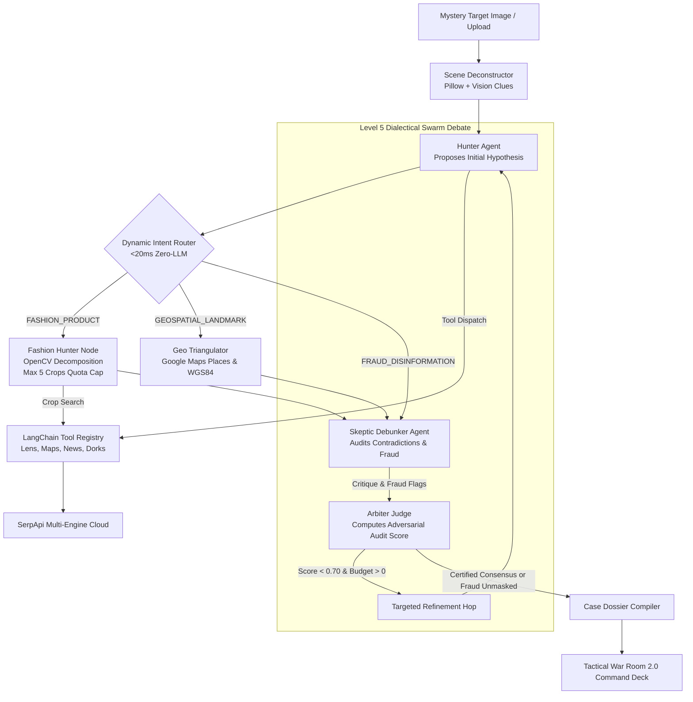

# 🌍 TerraSleuth — Level 5 Multi-Modal OSINT Detective Swarm

> **Official Submission for the SerpApi India Hackathon 2026** — *AI Agents Track*  
> Powered by **SerpApi Multi-Engine Cloud (Google Lens, Maps, News, Search)** & **LangGraph Dialectical Swarm**

[](https://serpapi.github.io/serpapi-india-hackathon-2026/#tracks)
[](C4-Documentation/)
[](C4-Documentation/c4-component-osint-agent-swarm.md)
[-brightgreen.svg)](docs/terrasleuth-regression-audit.md)
[](backend/app/services/cache_service.py)
[](docker-compose.yml)
[](LICENSE)

---

## 🏆 Why TerraSleuth Wins the SerpApi AI Agents Track

The hackathon challenge: *"Create agents that plan, search, compare, and act with current information. Research, RAG, Multi-agent, Automation."*

While generic hackathon projects wrap basic Google Search text endpoints into a single prompt, **TerraSleuth** orchestrates a **Level 4 ReAct Tool-Calling** and **Level 5 Dialectical Swarm (Hunter vs Skeptic vs Arbiter)** across **4 distinct SerpApi engines**:

| Hackathon Criterion | TerraSleuth Implementation & SerpApi Synergy |
|---|---|
| **Plan** | **Scene Deconstructor, Hybrid Vision Ensemble & HITL Directives:** Breaks mystery images into atomic visual clues (architecture, signage script, vegetation). Leverages a **Hybrid Vision Ensemble (Google AI Studio Gemini 1.5 Flash Spatial Vision + OpenCV)** to extract normalized 2D bounding boxes `[ymin, xmin, ymax, xmax]` for multi-object decomposition. Empowers detectives with **Human-in-the-Loop (HITL) Mission Directives** and label filtering checkpoints. Dynamically classifies intent (`GEOSPATIAL_LANDMARK`, `FASHION_PRODUCT`, `FRAUD_DISINFORMATION`, `GENERAL_OBJECT`) via two-tier semantic LLM reasoning with <20ms zero-cost heuristic fallback. |
| **Search** | **Autonomous Multi-Engine SerpApi Tools & Binary Image Upload API:** Dispatches `upload_image` via SerpApi Image API (`POST https://serpapi.com/image`) with Pillow iterative auto-resizing under 500 KB limit, `tool_lens_search` (reverse visual twins & regional bounding-box crops), `tool_maps_triangulate` (GPS coordinates & local place consensus), `tool_news_audit` (temporal historical archives), and `tool_google_dork` (municipal permits & open directories). |
| **Compare** | **Dialectical Red-Team Swarm (Hunter vs. Skeptic):** The **Hunter** proposes candidate locations or multi-item wardrobe catalog hypotheses; the **Skeptic** actively attempts to falsify them by checking climate contradictions, architectural mismatches, and fraud signals via `AnomalyService`; the **Arbiter** computes an `AdversarialAuditScore` and certifies the final verdict. |
| **Act** | **Geospatial Pinpoint & Court-Ready Dossier:** Resolves physical WGS84 coordinates on Esri satellite imagery, evaluates Geoguessr 5,000-point accuracy, unmasks rental fraud, renders an **Itemized Wardrobe & Product Forensic Ledger**, and generates a **1-click standalone offline HTML forensic dossier**. |
| **Research & RAG** | **Zero-Hallucination Real-Time Web Grounding:** Eliminates LLM spatial hallucinations by grounding every evidentiary claim in authoritative SerpApi URLs with exact timestamps. |
| **Multi-Agent & Automation** | **LangGraph State Machine with Adaptive Branching:** 100% autonomous execution from single mystery image to final case file with bounded refinement loops ($\le 2$ hops), adaptive routing bypassing Google Maps for fashion targets, and strict quota budget management (capping crop calls at max 5 items). |

---

## 🔍 Multi-Engine SerpApi Integration Depth

TerraSleuth unlocks the full commercial power of SerpApi beyond basic keyword search:

1. **`google_lens` (Visual Provenance, Local Upload API & Bounding-Box Crops):**
   - Direct binary image upload to SerpApi Image API (`POST https://serpapi.com/image`) with automatic iterative Pillow resizing/compression under 500 KB and SHA-256 caching.
   - Reverse-image searching distinguishing between exact matches and visual matches.
   - Authoritative source domain attribution and high-resolution thumbnail extraction.
   - Bounding-box sub-region crop searching via Pillow and normalized coordinate clamps (`tool_crop_region`).
2. **`google_maps` (Geospatial Triangulation & Consensus):**
   - Resolves uncaptioned photos to exact physical street addresses, place IDs, user reviews, and ratings.
   - Direct WGS84 latitude and longitude GPS mapping (`ll`).
3. **`google_news` (Chronological Provenance & Temporal Auditing):**
   - Audits publication timelines across historical date filters (`tbs`) to isolate earliest discovery dates.
   - Debunks recycled viral disinformation masquerading as current breaking events.
4. **`google` (Organic OSINT Dorking):**
   - Formulates targeted Google Search queries for municipal property records (`filetype:pdf`), government registries (`site:gov`), and exposed file trees (`intitle:"index of"`).

---

## 🎯 4 Flagship Real-World Scenarios

TerraSleuth addresses high-stakes open-source intelligence challenges:

### 1. 🚨 Bellingcat-Style Conflict & Disaster Verification
- **Problem:** Viral social media claims a photo represents a breaking crisis or human rights violation.
- **TerraSleuth Action:** SerpApi Google News timeline unmasks that the photograph was published years prior in a different geographic region, instantly debunking viral disinformation.

### 2. 🏖️ Vacation Rental & Marketplace Fraud Detection
- **Problem:** Scammer advertises an uncaptioned luxury apartment on Airbnb/Craigslist claiming it is a local residential rental.
- **TerraSleuth Action:** SerpApi Google Lens unmasks the listing as a copyrighted promotional photograph stolen from a boutique cliffside resort in Oia, Santorini, Greece, triggering a **CRITICAL FRAUD ALERT** banner.

### 3. 🎯 Autonomous Geoguessr Champion
- **Problem:** Uncaptioned mystery photo with no metadata.
- **TerraSleuth Action:** Progressively narrows spatial search radius from Continental (2,500km) to Street scale (<50m), achieving a **5,000-point competitive Geoguessr score** via Google Maps consensus.

### 4. 👗 Multi-Item Fashion & Wardrobe Visual Decomposition
- **Problem:** Cluttered flat-lay or moodboard image contains multiple touching items (dress, luxury bag, earrings, watch, bracelet, shoes). Standard reverse-image searches anchor on the dominant central dress and miss all accessories.
- **TerraSleuth Action:** Native OpenCV contour detection with chromatic/spatial sub-segmentation isolates each discrete item into normalized bounding boxes. The swarm adaptively routes to `fashion_hunter_node` (bypassing Google Maps), executes regional crop searches capped at max 5 items to defend quota, and generates an **Itemized Wardrobe & Product Forensic Ledger** with retailer sources and direct shopping links.

---

## 🧠 Enterprise Agentic Architecture

TerraSleuth is engineered using a LangGraph state machine featuring Level 4 ReAct tool dispatch and Level 5 Dialectical tension:



> 📚 **Complete Architectural Blueprints:** Explore our full [C4 Architecture Documentation](C4-Documentation/) covering:
> - [Level 1: System Context & Personas](C4-Documentation/c4-context.md)
> - [Level 2: Container Deployment & Docker Architecture](C4-Documentation/c4-container.md)
> - [Level 3: Master Component Index & Relationships](C4-Documentation/c4-component.md)
> - [OpenAPI 3.1 Contract Specification](C4-Documentation/apis/terrasleuth-warroom-api.yaml)
> - [Level 4: Code-Level Subsystem Specifications](C4-Documentation/)

---

## 🕹️ Tactical OSINT War Room 2.0 Command Deck

The user interface delivers a pure, distraction-free investigative workstation:

- **Heroic Landing & Mission Briefings:** High-tech HUD banner and 1-click briefing cards for instant benchmark selection.
- **45/55 Split-Screen Command Deck:**
  - **Left (45%):** Visual Forensic Inspector with labeled bounding box clues and Side-by-Side Visual Twin Matcher (`Visual Correspondence %`).
  - **Right (55%):** Tactical Esri World Imagery Satellite Recon Map, consensus address banner, Itemized Wardrobe & Product Forensic Ledger (when fashion intent is detected), and 5 intelligence tabs (`Geoguessr Mode`, `Chronology`, `Citations`, `OSINT Dorks`, `Executive Dossier`).
- **Live Glass-Box Swarm Telemetry Terminal:** High-contrast monospace terminal (`#090d16`) streaming real-time agent deductions, timestamps, and neon role badges (`[HUNTER]`, `[SKEPTIC]`, `[ARBITER]`).
- **1-Click Standalone Offline HTML Dossier Exporter:** Exports complete, zero-dependency HTML intelligence reports with embedded Base64 images, verification badges, wardrobe tables, and print stylesheets.

---

## 🛡️ Zero-Quota Cache Defense & Enterprise Reliability

Agentic loops can quickly drain API quotas. TerraSleuth features a production-hardened caching architecture:

- **SQLite WAL Disk Cache (`terrasleuth.db`):** All SerpApi queries are cached using deterministic SHA-256 parameter hashing (stripping API keys and transient flags).
- **Zero Credits Burned in Demos:** Pre-seeded golden benchmark targets (Gateway of India, Neuschwanstein Castle, Santorini Rental Scam) run **100% offline with zero live credit consumption**.
- **Circuit Breaker Quota Manager:** Session budget manager tracks live network queries and terminates runaway loops immediately.
- **127/127 Automated Tests Passing:** Validated across 19 backend unit suites, 6 frontend UI suites, and end-to-end browser workflows.

---

## 🚀 Quickstart & Verification

### 1. Launch via Docker Compose (Recommended)
Spins up the web application and pre-seeds the SQLite cache database automatically:
```bash
docker compose up --build
```
Navigate to **`http://localhost:8501`** in your browser.

### 2. Local Manual Installation
```bash
# Clone the repository
git clone https://github.com/Siddhant75/TerraSleuth.git
cd TerraSleuth

# Install dependencies
pip install -r requirements.txt

# Configure environment (Optional: Golden Demos run 100% offline without a key)
cp .env.example .env
# Edit .env and set SERPAPI_API_KEY=your_key_here

# Launch the Tactical Command Deck
streamlit run frontend/app.py
```

### 3. Run the Full Automated Test Suite (140/140 Tests)
Run unit, integration, and E2E regression tests with zero API credit consumption:
```bash
# Linux / macOS
PYTHONPATH=. pytest backend/tests/ frontend/tests/ tests/e2e/test_dashboard_e2e.py -v

# Windows (PowerShell)
$env:PYTHONPATH="." ; pytest backend/tests/ frontend/tests/ tests/e2e/test_dashboard_e2e.py -v
```

### 4. CLI Live SerpApi Scenario Verification
Verify live or cached SerpApi network calls across flagship targets or custom uploaded images:
```bash
# Test pre-seeded flagship targets (100% cached / 0 credits burned)
python scripts/test_live_serpapi.py --allow-cached

# Test custom local image upload via SerpApi Image API
python scripts/test_live_serpapi.py --image-path "tests/live-test/clothing/download (1).jpeg" --api-key "your_serpapi_key"
```

---

## 📜 Key Project Documentation

- **[docs/hackathon-submission.md](docs/hackathon-submission.md):** Official Hackathon submission writeup and judging guide.
- **[C4-Documentation/](C4-Documentation/):** Full C4 Architecture Model (Context, Container, Component, Code + OpenAPI 3.1).
- **[docs/terrasleuth-roadmap.md](docs/terrasleuth-roadmap.md):** Living roadmap, sprint milestones (v0.1 through v0.8), and commit log.
- **[docs/terrasleuth-regression-audit.md](docs/terrasleuth-regression-audit.md):** Subsystem health scorecard and multi-point regression verification report.
- **[AGENTS.md](AGENTS.md):** Master architecture navigation guide for AI coding agents.

---

## ⚖️ License

Distributed under the MIT License. See [`LICENSE`](LICENSE) for details.
